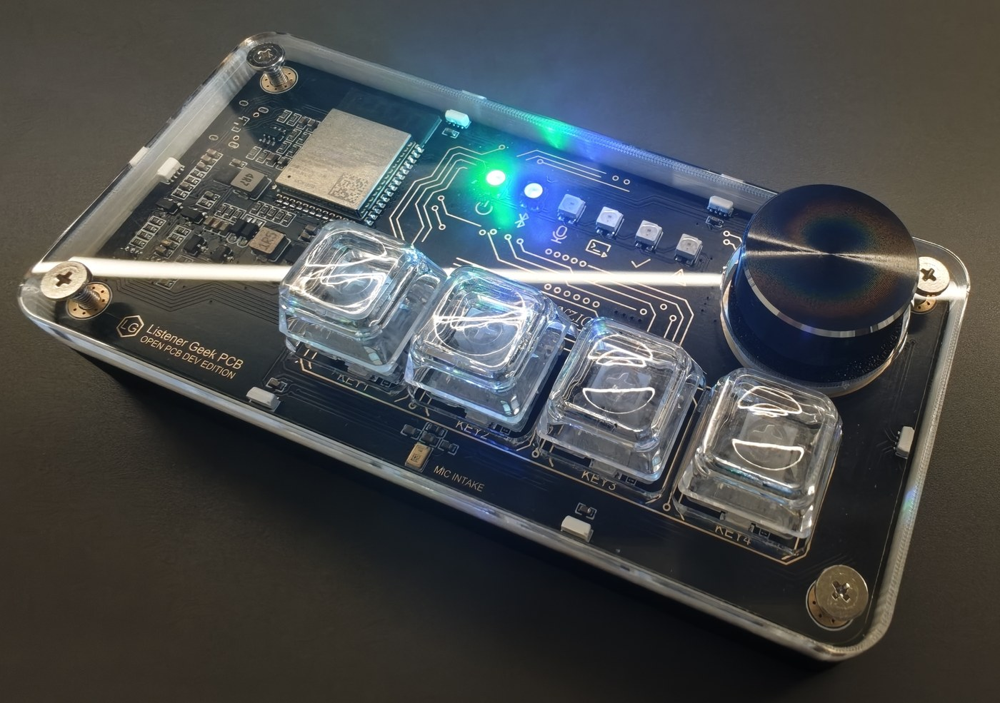
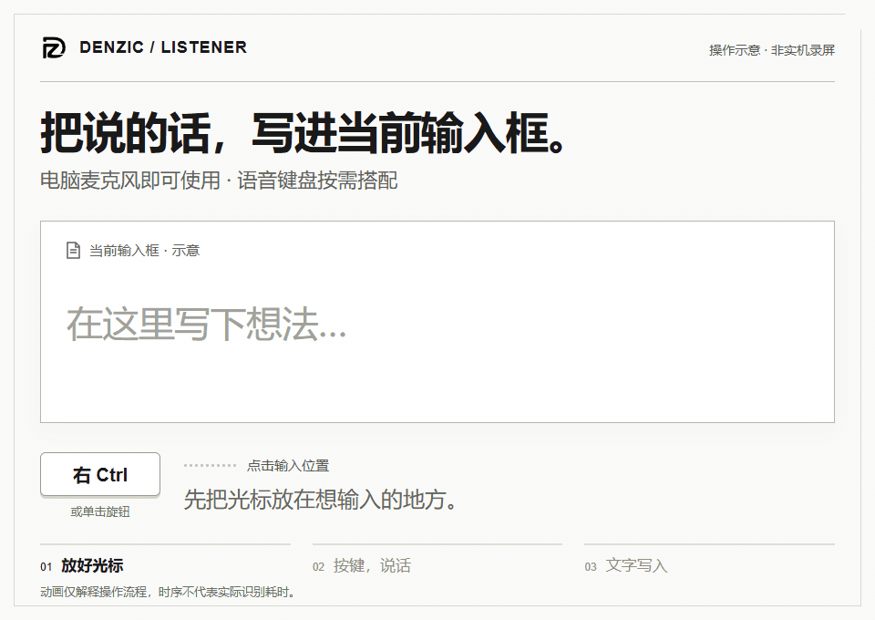
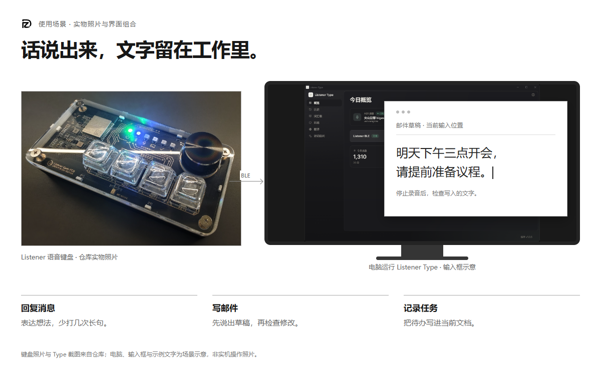
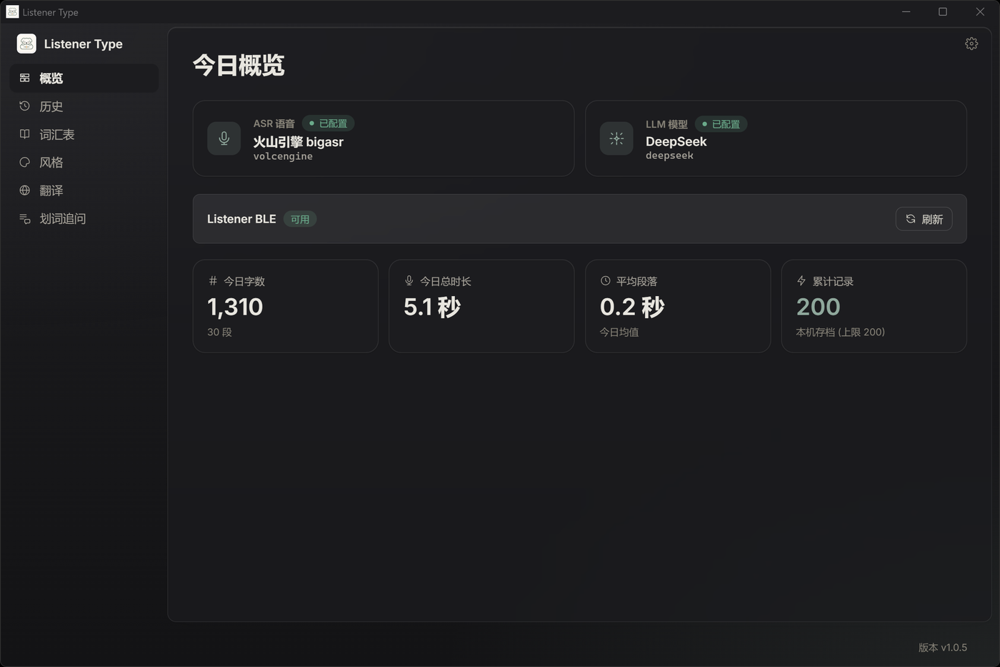

# Listener Type

开源语音输入软件。用电脑麦克风或 Listener 键盘说话，把文字写入光标所在的输入框。

[下载 Windows 版](https://github.com/Listener-ai-Macau/Listener-Type/releases) · [第一次听写](#先完成一次输入) · [使用指南](docs/USAGE.md) · [反馈问题](https://github.com/Listener-ai-Macau/Listener-Type/issues/new/choose)

Windows x64 编号预发布包内含 Companion Paraformer Large，可本地转写中文和英文。请在 Releases 选最新编号预发布，并核对该页的 SHA-256。用电脑麦克风即可开始，无需账号或云端密钥。

[English](README.md) · **简体中文** · [繁體中文](README.zh-TW.md)

## Listener 键盘

可选的 Listener 键盘自带麦克风、录音旋钮和四颗可自定义按键，硬件价格为 49 美元。[固件及硬件说明](https://github.com/Listener-ai-Macau/Listener-Firmware) · [RC1 固件 ZIP](https://github.com/Listener-ai-Macau/Listener-Firmware/releases/tag/v1.0.6-rc1)



*Listener 实物照片。计划交付外观基本如图：透明外壳、透明键帽、黑色旋钮；此图不是操作录像。*

- **说出来：** 旋钮开停录音，电脑上的 Type 完成识别与写入。
- **按需要整理：** 默认保留原文，也可在配置文字服务后选择风格或翻译。
- **设成自己的：** 自定义四颗按键、灯光和电源设置，每台设备独立保存。

**[听一条消息变成文字 · 约25秒软件示例](docs/VOICE_EXAMPLE.zh-CN.md)。** 预录合成人声与 Type 实际结果，未展示硬件操作；原音为英文。

Windows 预发布包自带本地识别模型。需要使用云服务时，可填写自己的凭据，费用和额度由服务方决定。

**RC1 仍为候选版本。** 强干扰分离尚未完善，偶发提前结束仍在跟进，详见[当前限制与发布说明](https://github.com/Listener-ai-Macau/Listener-Type/releases)。硬件购买入口尚未公布。

[首次设置](https://github.com/Listener-ai-Macau/Listener-Type/blob/master/README.zh-CN.md#先完成一次输入) · [需要时再查使用指南](https://github.com/Listener-ai-Macau/Listener-Type/blob/master/docs/USAGE.md)

<details>
<summary>已有设备：固件、设置与本次版本</summary>

固件适用 **ESP32-S3 N16R8**，构建 `094f5a60049f59f4`。USB 和蓝牙更新选择同一个 ZIP，无需再猜下载哪一个。
Type 默认使用 **USB 有线刷机**，刷机能力已内置；客户无需另装 Python、ESP-IDF 或其它刷机软件。
设备设置各自独立：选择一台有线／蓝牙设备并读取；完成编辑后自动保存明确修改，读取或切换设备不会写入电脑默认值。名称、灯光、电源、按键和旋钮设置保存在所选设备中。请配套使用本页 MSI 与固件 ZIP。

自动输入源优先使用就绪的 Listener 设备，设备断开时切到电脑麦克风。进行中的录音沿原输入源收尾。也可在「设置 → 录音」或托盘固定输入源。

[Release notes / 发布说明](https://github.com/Listener-ai-Macau/Listener-Type/releases) · [Firmware / 固件](https://github.com/Listener-ai-Macau/Listener-Firmware/releases/tag/v1.0.6-rc1)

</details>

---

## 不用离开正在写的地方

<picture>
  <source media="(prefers-reduced-motion: reduce) and (max-width: 600px)" srcset="docs/assets/listener/Listener-demo-zh-mobile-poster.png">
  <source media="(prefers-reduced-motion: reduce)" srcset="docs/assets/listener/Listener-demo-zh-poster.png">
  <source media="(max-width: 600px)" srcset="docs/assets/listener/Listener-demo-zh-mobile.gif">
  
</picture>

1. 在目标输入框放好光标。
2. 用自己设置的录音快捷键或 Listener 旋钮开始，说一句话，再用同一操作结束。
3. 检查写入的文字；目标应用阻止写入时，按提示粘贴。

电脑快捷键首次均未设置，需要哪项再到「设置 → 快捷键」录入；更新保留已有个人绑定。图中是流程示意，不是实机录屏。默认原文模式（Raw）保留措辞；需要时选择整理风格或翻译。

## 先完成一次输入

| 你现在有什么 | 从哪里开始 |
| --- | --- |
| 只有电脑 | 安装软件，允许麦克风访问，在「设置 → 录音」选择**电脑麦克风**。 |
| 已有 Listener 键盘 | 在「设置 → 设备」配对 `listener`，确认就绪；录音来源选 **Listener BLE**。 |

Windows 全新安装默认使用 Companion Paraformer Large。已有的识别服务设置会保留。先在记事本试录一句，再按需设置云服务。

Windows 是主要安装与完整键盘音频路径。macOS / Linux 当前从源码构建，详见下方平台说明。

### 软件免费，服务费用分别计算

软件免费。原文听写可用内置本地模型，云服务费用由各提供方决定。

<details>
<summary>展开费用、本地模型与首次配置说明</summary>

- **软件：** Listener Type 免费开源；正常本机使用不需要 Listener 账号，也不必先买键盘。
- **云服务：** 使用你自己的语音识别或文字服务凭据，费用、额度和试用条件由对应提供方决定。软件不附带云端密钥。
- **无云端密钥：** 用内置 Companion Paraformer Large 和电脑麦克风进行原文（Raw）听写。识别速度取决于电脑。文字整理、翻译和语音问答按各功能要求单独配置。

[查看识别服务与本地模型设置](docs/USAGE.md#识别服务与网络)

</details>

## 从原话，到你需要的表达

| 你的需要 | 对应能力 |
| --- | --- |
| 直接记录原话 | 原文模式（Raw）、录音胶囊预览、光标插入与剪贴板回退 |
| 整理聊天或邮件 | 轻度整理（Light）/ 正式表达（Formal）；多事项可选“日常清单” |
| 为 AI 编程工具准备技术指令 | 结构化（Structured）；风格支持编辑与 ZIP 导入导出 |
| 换一种语言表达 | 先选目标语言，录音中用自己设置的翻译快捷键启用本次翻译 |
| 少改几次专有名词 | 本机词库、预设、字面纠错规则 |
| 对一段文字提问 | 先在「设置 → 快捷键」设置提问快捷键，选中文字后用该快捷键打开问答 |
| 找回刚才的结果 | 历史查看、复制、删除与保留期限设置 |

流式输入保持开启，不再提供关闭开关；实际是否逐段写入取决于平台、模式和服务。录音胶囊里的文字是预览，不代表已经写入目标输入框。

**问答配置：** 语音提问目前固定使用火山引擎流式识别，需配置 App Key / Access Key 和文字服务；普通听写的其他识别服务或本地模型不能替代这项配置。

**默认是原文模式（Raw），整理和翻译按需配置。** 下面是选择轻度整理（Light） 并配置文字服务后的示意，不是准确率或逐字输出承诺：

> 说：“嗯，提醒我明天下午三点开会。”  
> 整理示意：“提醒我明天下午三点开会。”

## 一只旋钮，四个按键，六颗状态灯

**49 美元是硬件价格：** 包含设备自己的麦克风、传给 Type 的蓝牙音频、录音／音量旋钮、四个可自定义按键和六颗状态灯。麦克风与控制可以放在工作时顺手的位置，每台设备保留各自设置。

免费软件可使用电脑麦克风，需要时自行设置录音快捷键；选用 Listener 时，声音来自设备麦克风。两种方式都使用电脑上配置的识别服务或本地模型，硬件价格不包含云端用量。完整设备音频路径需要 Windows Type；噪声或多人同说时仍需复核文字。


**键盘为可选配件，目前处于预售阶段，购买入口尚未公布。软件可先独立使用。**

<picture>
  <source media="(prefers-color-scheme: dark) and (max-width: 600px)" srcset="docs/assets/listener/usage-scene-zh-mobile-dark.png">
  <source media="(prefers-color-scheme: dark)" srcset="docs/assets/listener/usage-scene-zh-dark.png">
  <source media="(max-width: 600px)" srcset="docs/assets/listener/usage-scene-zh-mobile.png">
  
</picture>

实物照片与软件截图来自仓库；电脑、输入框和示例文字为场景示意。

在「设置 → 设备」连接键盘。旋钮单击开始 / 停止，旋转默认调音量；双击重置配对，持续长按到确认完成后关机。四键支持自定义单击、双击与长按。

唤醒词与声纹也在**设备页**配置：按引导录三次当前唤醒词；改词后重新录制。声纹用于减少输入干扰，噪声与多人说话时仍需检查最终文字。删除声纹不会关闭语音唤醒。声纹向导在本机生成受保护模板，完成后不保留原始样本录音。

[硬件操作与灯语](https://github.com/Listener-ai-Macau/Listener-Firmware/blob/master/README.zh-CN.md) · [折页使用说明](docs/manuals/Listener-fold-ZH.pdf)

## 服务由你配置，数据去向看得清

设置、词库、风格和历史保存在本机，凭据使用系统凭据库。云端识别处理音频，云端整理、翻译与问答处理相关文字；本地识别搭配云端文字服务仍会发送文字。调试录音默认关闭。

可按服务选择直连、系统代理或自定义代理。远程市场默认未配置，正常的本机使用不依赖 Listener 后端或账号登录。

## 平台与当前范围

| 平台 | 当前路径 |
| --- | --- |
| Windows | MSI 安装包；电脑麦克风与主要 Listener BLE 音频、设备配置路径 |
| macOS 12+ | 规划中：Apple Speech 识别、辅助功能插入、正式安装包。当前可从源码构建：电脑麦克风、本地模型识别、全局快捷键 |
| Linux | 源码构建；电脑麦克风；X11 快捷键尽力支持，Wayland 使用桌面快捷键绑定 CLI |

Windows MSI 会注册用于[文字写入的 TSF 组件](docs/platform/windows-ime.md)。自动唤醒和声纹依赖清晰人声，多人同时说话时请复核结果。

<details>
<summary>查看软件界面</summary>



仓库现有截图；其中的统计和服务配置是示例。

</details>

## 文档与开发

遇到连接、录音或文字写入问题，可先查折页第 08 面。仍有问题时，查看[反馈说明](SUPPORT.zh-CN.md)，在[问题反馈页](https://github.com/Listener-ai-Macau/Listener-Type/issues)提供软件版本、系统和输入来源；使用键盘时一并提供固件版本。

[使用说明](docs/USAGE.md) · [功能目录](docs/product/features.md) · [发布记录](https://github.com/Listener-ai-Macau/Listener-Type/releases) · [贡献指南](CONTRIBUTING.zh-CN.md) · [安全](SECURITY.zh-CN.md)

从源码开发请看[贡献指南](CONTRIBUTING.zh-CN.md)，完整桌面构建需要固定版本的 Denzic Platform 子模块。

```bash
npm ci
npm run build
cargo check --manifest-path src-tauri/Cargo.toml
```

软件与固件分别开源。

[Apache-2.0](https://github.com/Listener-ai-Macau/Listener-Type/blob/master/LICENSE)
