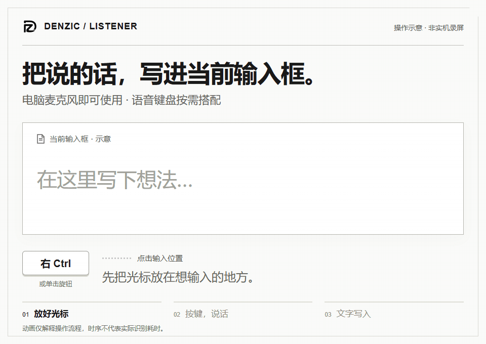
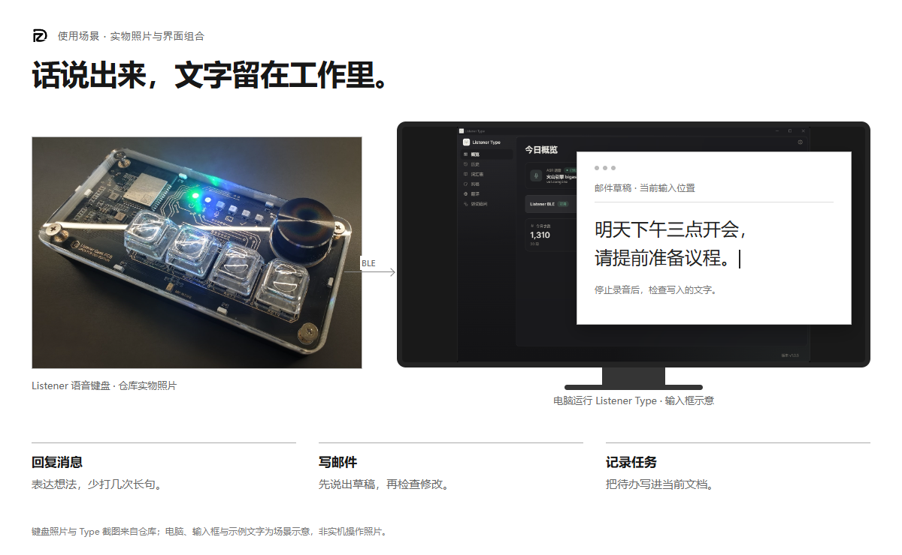
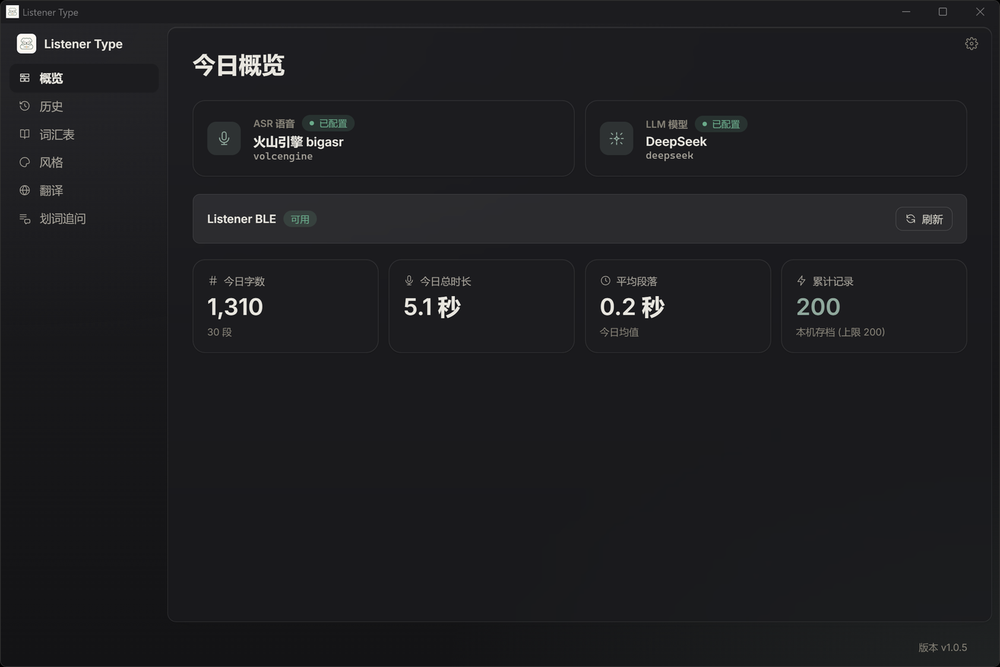

# Listener

## 放在桌边的 AI 入门小工具 · 49 美元


一个麦克风、一个录音旋钮、四颗可自定义按键。配合 Windows Type，用说话起草消息、邮件或笔记，文字进入正在使用的输入框。

**49 美元为硬件价格，Type 软件免费开源。**

| 用途 | 直接下载 |
| --- | --- |
| **Windows 软件** | **[下载 MSI · Type build220](https://github.com/Listener-ai-Macau/Listener-Type/releases/download/v1.0.6-rc1/ListenerType_1.0.6-rc1_x64_en-US.msi)** |
| **固件：USB 烧写 / 蓝牙 OTA** | **[下载固件 ZIP · 两种方式共用](https://github.com/Listener-ai-Macau/Listener-Firmware/releases/download/v1.0.6-rc1/ListenerFirmware_1.0.6-rc1_ESP32S3.zip)** |

<!-- listener-local-text-entry -->
**没有硬件或云 Key，也能先试：** [下载 Windows MSI](https://github.com/Listener-ai-Macau/Listener-Type/releases/download/v1.0.6-rc1/ListenerType_1.0.6-rc1_x64_en-US.msi)，打开「概览 → 本机中英翻译」，首次明确下载所需组件即可。文字翻译无逐次 API 费用；语音识别另行配置。[具体设置](https://github.com/Listener-ai-Macau/Listener-Type/blob/master/docs/USAGE.md)。

[English](README.md) · **简体中文** · [繁體中文](README.zh-TW.md)


*Listener 实物照片。计划交付外观基本如图：透明外壳、透明键帽、黑色旋钮；此图不是操作录像。*

- **说出来：** 旋钮开停录音，电脑上的 Type 完成识别与写入。
- **按需要整理：** 默认保留原文，也可在配置文字服务后选择风格或翻译。
- **设成自己的：** 自定义四颗按键、灯光和电源设置，每台设备独立保存。

**[听一条消息变成文字 · 约25秒软件示例](docs/VOICE_EXAMPLE.zh-CN.md)。** 预录合成人声与 Type 实际结果，未展示硬件操作；原音为英文。

**开始前需要：** Windows Type，以及已配置的识别服务或本地模型。云端用量单独计费；当前版本不附带开箱可用的官方云账号或识别额度。

**RC1 仍为候选版本。** 强干扰分离尚未完善，偶发提前结束仍在跟进，详见[当前限制与发布说明](https://github.com/Listener-ai-Macau/Listener-Type/releases/tag/v1.0.6-rc1)。硬件购买入口尚未公布。

[首次设置](https://github.com/Listener-ai-Macau/Listener-Type/blob/master/README.zh-CN.md#先完成一次输入) · [需要时再查使用指南](https://github.com/Listener-ai-Macau/Listener-Type/blob/master/docs/USAGE.md)

<details>
<summary>已有设备：固件、设置与本次版本</summary>

固件适用 **ESP32-S3 N16R8**，构建 `094f5a60049f59f4`。USB 和蓝牙更新选择同一个 ZIP，无需再猜下载哪一个。
Type 默认使用 **USB 有线刷机**，刷机能力已内置；客户无需另装 Python、ESP-IDF 或其它刷机软件。
设备设置各自独立：选择一台有线／蓝牙设备并读取；完成编辑后自动保存明确修改，读取或切换设备不会写入电脑默认值。名称、灯光、电源、按键和旋钮设置保存在所选设备中。请配套使用本页 MSI 与固件 ZIP。

Type build220 在轻量离线翻译中按原文核对可识别的时间，保留明确时段及之前／之后关系，不补猜未写出的时段；保留明确日期年份和段落。无法可靠对应时保留原文并提示核对。译文仍是可编辑初稿，原稿、保存副本及按需设置电脑快捷键的方式保留。固件38不变。

[Release notes / 发布说明](https://github.com/Listener-ai-Macau/Listener-Type/releases/tag/v1.0.6-rc1) · [Firmware / 固件](https://github.com/Listener-ai-Macau/Listener-Firmware/releases/tag/v1.0.6-rc1)

</details>

---

## 不用离开正在写的地方

<picture>
  <source media="(prefers-reduced-motion: reduce) and (max-width: 600px)" srcset="docs/assets/listener/Listener-demo-zh-mobile-poster.png">
  <source media="(prefers-reduced-motion: reduce)" srcset="docs/assets/listener/Listener-demo-zh-poster.png">
  <source media="(max-width: 600px)" srcset="docs/assets/listener/Listener-demo-zh-mobile.gif">
  
</picture>

1. 在目标输入框放好光标。
2. 按右 Ctrl 开始，说一句话，再按一次结束。
3. 检查写入的文字；目标应用阻止写入时，按提示粘贴。

图中是流程示意，不是实机录屏。默认原文模式（Raw）保留措辞；需要时选择整理风格或翻译。

## 先完成一次输入

| 你现在有什么 | 从哪里开始 |
| --- | --- |
| 只有电脑 | 安装软件，允许麦克风访问，在「设置 → 录音」选择**电脑麦克风**。 |
| 已有 Listener 键盘 | 在「设置 → 设备」配对 `listener`，确认就绪；录音来源选 **Listener BLE**。 |

接着选识别服务：填写提供方要求的凭据与模型，或在本地识别设置中准备运行时和模型。先在记事本试一句话，看到文字再开始日常使用。

Windows 是主要安装与完整键盘音频路径。macOS / Linux 当前从源码构建，详见下方平台说明。

### 软件免费，服务费用分别计算

软件免费；云服务费用由提供方决定。没有云端密钥，可先准备 Windows 本地模型并用原文模式（Raw）听写。

<details>
<summary>展开费用、本地模型与首次配置说明</summary>

- **软件：** Listener Type 免费开源；正常本机使用不需要 Listener 账号，也不必先买键盘。
- **云服务：** 使用你自己的语音识别或文字服务凭据，费用、额度和试用条件由对应提供方决定。软件不附带云端密钥。
- **没有云端密钥：** Windows 可先在本地识别设置中准备 Foundry Local 运行时与 Whisper 模型，选择电脑麦克风，用原文模式（Raw）试录。本地识别无需云端识别密钥；首次需下载模型，速度取决于电脑。整理、翻译与语音问答另有服务配置要求。

[查看识别服务与本地模型设置](docs/USAGE.md#识别服务与网络)

</details>

## 从原话，到你需要的表达

| 你的需要 | 对应能力 |
| --- | --- |
| 直接记录原话 | 原文模式（Raw）、录音胶囊预览、光标插入与剪贴板回退 |
| 整理聊天或邮件 | 轻度整理（Light）/ 正式表达（Formal）；多事项可选“日常清单” |
| 为 AI 编程工具准备技术指令 | 结构化（Structured）；风格支持编辑与 ZIP 导入导出 |
| 换一种语言表达 | 先选目标语言，录音中按 Shift 启用本次翻译 |
| 少改几次专有名词 | 本机词库、预设、字面纠错规则 |
| 对一段文字提问 | 选中内容，Ctrl+Shift+; 打开问答窗口，再用录音键提问 |
| 找回刚才的结果 | 历史查看、复制、删除与保留期限设置 |

流式插入开关默认开启，实际是否逐段写入取决于平台、模式和服务。录音胶囊里的文字是预览，不代表已经写入目标输入框。

**问答配置：** 语音提问目前固定使用火山引擎流式识别，需配置 App Key / Access Key 和文字服务；普通听写的其他识别服务或本地模型不能替代这项配置。

**默认是原文模式（Raw），整理和翻译按需配置。** 下面是选择轻度整理（Light） 并配置文字服务后的示意，不是准确率或逐字输出承诺：

> 说：“嗯，提醒我明天下午三点开会。”  
> 整理示意：“提醒我明天下午三点开会。”

## 一只旋钮，四个按键，六颗状态灯

**49 美元是硬件价格：** 包含设备自己的麦克风、传给 Type 的蓝牙音频、录音／音量旋钮、四个可自定义按键和六颗状态灯。麦克风与控制可以放在工作时顺手的位置，每台设备保留各自设置。

免费软件可使用电脑麦克风和 Right Ctrl；选用 Listener 时，声音来自设备麦克风。两种方式都使用电脑上配置的识别服务或本地模型，硬件价格不包含云端用量。完整设备音频路径需要 Windows Type；噪声或多人同说时仍需复核文字。


**键盘为可选配件，目前处于预售阶段，购买入口尚未公布。软件可先独立使用。**

<picture>
  <source media="(prefers-color-scheme: dark) and (max-width: 600px)" srcset="docs/assets/listener/usage-scene-zh-mobile-dark.png">
  <source media="(prefers-color-scheme: dark)" srcset="docs/assets/listener/usage-scene-zh-dark.png">
  <source media="(max-width: 600px)" srcset="docs/assets/listener/usage-scene-zh-mobile.png">
  
</picture>

实物照片与软件截图来自仓库；电脑、输入框和示例文字为场景示意。

在「设置 → 设备」连接键盘。旋钮单击开始 / 停止，旋转默认调音量；双击重置配对，持续长按到确认完成后关机。四键支持自定义单击、双击与长按。

唤醒词与声纹也在**设备页**配置：按引导录三次当前唤醒词；改词后重新录制。声纹用于减少输入干扰，噪声与多人说话时仍需检查最终文字。删除声纹不会关闭语音唤醒。声纹向导在本机生成受保护模板，完成后不保留原始样本录音。

[硬件操作与灯语](https://github.com/Listener-ai-Macau/Listener-Firmware/blob/master/README.zh-CN.md) · [折页使用说明](docs/manuals/Listener-fold-ZH.pdf)

## 服务由你配置，数据去向看得清

设置、词库、风格和历史保存在本机，凭据使用系统凭据库。云端识别处理音频，云端整理、翻译与问答处理相关文字；本地识别搭配云端文字服务仍会发送文字。调试录音默认关闭。

可按服务选择直连、系统代理或自定义代理。远程市场默认未配置，正常的本机使用不依赖 Listener 后端或账号登录。

## 平台与当前范围

| 平台 | 当前路径 |
| --- | --- |
| Windows | MSI 安装包；电脑麦克风与主要 Listener BLE 音频、设备配置路径 |
| macOS 12+ | 规划中：Apple Speech 识别、辅助功能插入、正式安装包。当前可从源码构建：电脑麦克风、本地模型识别、全局快捷键 |
| Linux | 源码构建；电脑麦克风；X11 快捷键尽力支持，Wayland 使用桌面快捷键绑定 CLI |

标准安装包不注册系统输入法。自动唤醒与声纹不保证在任意距离、噪声或多人重叠场景下可靠分离。

<details>
<summary>查看软件界面</summary>



仓库现有截图；其中的统计和服务配置是示例。

</details>

## 文档与开发

遇到连接、录音或文字写入问题，可先查折页第 08 面。仍有问题时，查看[反馈说明](SUPPORT.zh-CN.md)，在[问题反馈页](https://github.com/Listener-ai-Macau/Listener-Type/issues)提供软件版本、系统和输入来源；使用键盘时一并提供固件版本。

[使用说明](docs/USAGE.md) · [功能目录](docs/product/features.md) · [发布记录](https://github.com/Listener-ai-Macau/Listener-Type/releases) · [贡献指南](CONTRIBUTING.zh-CN.md) · [安全](SECURITY.zh-CN.md)

Tauri 2 / Rust / React / TypeScript / Vite。完整桌面构建还需要 `third_party/denzic-platform` 子模块。

```bash
npm ci
npm run build
cargo check --manifest-path src-tauri/Cargo.toml
```

软件与固件分别开源。

[Apache-2.0](https://github.com/Listener-ai-Macau/Listener-Type/blob/master/LICENSE)
