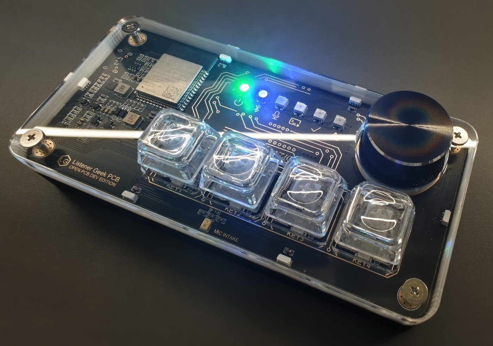

# Listener

## 放在桌邊的 AI 入門小工具 · 49 美元


一個麥克風、一個錄音旋鈕、四顆可自訂按鍵。配合 Windows Type，用說話起草訊息、郵件或筆記，文字進入正在使用的輸入框。

**49 美元為硬體價格，Type 軟體免費開源。**

| 用途 | 直接下載 |
| --- | --- |
| **Windows 軟體** | **[下載 MSI · Type build217](https://github.com/Listener-ai-Macau/Listener-Type/releases/download/v1.0.6-rc1/ListenerType_1.0.6-rc1_x64_en-US.msi)** |
| **韌體：USB 燒寫 / 藍牙 OTA** | **[下載韌體 ZIP · 兩種方式共用](https://github.com/Listener-ai-Macau/Listener-Firmware/releases/download/v1.0.6-rc1/ListenerFirmware_1.0.6-rc1_ESP32S3.zip)** |

<!-- listener-local-text-entry -->
**沒有硬體或雲端 Key，也能先試：** [下載 Windows MSI](https://github.com/Listener-ai-Macau/Listener-Type/releases/download/v1.0.6-rc1/ListenerType_1.0.6-rc1_x64_en-US.msi)，開啟「概覽 → 本機中英翻譯」，首次明確下載所需元件即可。文字翻譯無逐次 API 費用；語音識別另行設定。[詳細設定](https://github.com/Listener-ai-Macau/Listener-Type/blob/master/docs/USAGE.md)。

[English](README.md) · **繁體中文** · [简体中文](README.zh-CN.md)



*Listener 實物照片。計劃交付外觀基本如圖：透明外殼、透明鍵帽、黑色旋鈕；此圖不是操作錄影。*

- **說出來：** 旋鈕開停錄音，電腦上的 Type 完成辨識與寫入。
- **按需要整理：** 預設保留原文，也可在設定文字服務後選擇風格或翻譯。
- **設成自己的：** 自訂四顆按鍵、燈光與電源設定，每台裝置獨立儲存。

**[聽一條訊息變成文字 · 約25秒軟體示例](docs/VOICE_EXAMPLE.zh-CN.md)。** 預錄合成人聲與 Type 實際結果，未展示硬體操作；原音為英文。

**開始前需要：** Windows Type，以及已設定的辨識服務或本機模型。雲端用量單獨計費；目前版本不附帶開箱可用的官方雲端帳號或辨識額度。

**RC1 仍為候選版本。** 強干擾分離尚未完善，偶發提前結束仍在跟進，詳見[目前限制與發布說明](https://github.com/Listener-ai-Macau/Listener-Type/releases/tag/v1.0.6-rc1)。硬體購買入口尚未公布。

[首次設定](https://github.com/Listener-ai-Macau/Listener-Type/blob/master/README.zh-TW.md#先完成一次輸入) · [需要時再查使用指南](https://github.com/Listener-ai-Macau/Listener-Type/blob/master/docs/USAGE.md)

<details>
<summary>已有裝置：韌體、設定與本次版本</summary>

韌體適用 **ESP32-S3 N16R8**，建置 `094f5a60049f59f4`。USB 與藍牙更新選擇同一個 ZIP。
Type 預設使用 **USB 有線燒寫**，能力已內建；無需另裝 Python、ESP-IDF 或其他燒寫軟體。
裝置設定各自獨立：選擇一台有線／藍牙裝置並讀取；完成編輯後自動儲存明確修改，讀取或切換裝置不會寫入電腦預設值。名稱、燈光、電源、按鍵與旋鈕設定儲存在所選裝置。請配套使用本頁 MSI 與韌體 ZIP。

Type build217 首次使用的五項電腦快捷鍵均不綁定；需要哪項再自行錄入，也可逐項清除，更新保留已有個人綁定。 多步翻譯、潤飾及已儲存成稿繼續編輯時，會隨最終稿保留最初輸入。潤飾中可回到完整翻譯前原文準備雲端重譯，核對費用後明確提交，也可返回原修訂稿。已有WAV匯入入口在概覽及工具頁直接可見。輕量CPU翻譯及韌體38不變。

[Release notes / 发布说明](https://github.com/Listener-ai-Macau/Listener-Type/releases/tag/v1.0.6-rc1) · [Firmware / 固件](https://github.com/Listener-ai-Macau/Listener-Firmware/releases/tag/v1.0.6-rc1)

</details>

---

## 先完成一次輸入

| 你現在有什麼 | 從哪裡開始 |
| --- | --- |
| 只有電腦 | 安裝 MSI，允許麥克風存取，在「設定 → 錄音」選擇**電腦麥克風**。 |
| 已有 Listener | 在「設定 → 裝置」配對，確認就緒；錄音來源選 **Listener BLE**。 |

接著設定辨識服務所需憑證與模型，或在本機辨識設定中準備執行環境及模型。把游標放進可編輯欄位，按右 Ctrl 開始，說一句話，再按一次結束；使用 Listener 時也可單擊旋鈕開始／結束。

軟體免費，正常本機使用無需 Listener 帳號。雲端服務自備憑證，費用、額度與試用條件由提供方決定；軟體不內附雲端密鑰。Windows 可準備 Foundry Local 與 Whisper 進行本機原文辨識，首次需下載，速度取決於電腦。文字整理、翻譯與語音問答另有服務需求。

## 原文與整理按需要選擇

| 你的目的 | 對應能力 |
| --- | --- |
| 保留措辭 | 預設原文模式（Raw）、錄音膠囊預覽、游標插入與剪貼簿備援 |
| 整理訊息或郵件 | Light / Formal；多事項可選「日常清單」，需設定文字服務 |
| 為 AI 程式設計工具準備技術指令 | Structured；風格可編輯與匯入／匯出 |
| 翻譯 | 先選目標語言，錄音時按 Shift 啟用本次翻譯；需設定相應服務 |
| 協助辨識人名與術語 | 本機詞庫、預設與字面糾錯規則 |
| 取回剛才的結果 | 歷史查看、複製、刪除與保留期限設定 |

串流插入預設開啟，實際逐段寫入取決於平台、模式與服務。膠囊文字為預覽，不代表已寫入目標欄位；目標應用阻擋寫入時，依提示貼上並檢查結果。

語音問答目前固定使用火山引擎串流辨識，需 App Key / Access Key 與文字服務；普通聽寫所選的其他辨識服務或本機模型不能替代這項設定。

## 一只旋鈕、四個按鍵、六顆狀態燈

在「設定 → 裝置」連接。單擊旋鈕開始／停止錄音，旋轉預設調音量；雙擊重設配對，持續長按至確認完成後關機。四鍵支援自訂單擊、雙擊與長按，各裝置保留自己的設定。

喚醒詞與聲紋在裝置頁設定。依引導錄三次目前喚醒詞，改詞後重新登記。聲紋可協助降低干擾，但不能保證排除旁人、外放或重疊人聲；這些情況仍需複核最後文字。刪除聲紋不會關閉語音喚醒。登記後在本機建立受保護模板，不保留原始樣本錄音。

[硬體操作與燈語](https://github.com/Listener-ai-Macau/Listener-Firmware/blob/master/README.zh-TW.md) · [折頁指南（簡體中文）](docs/manuals/Listener-fold-ZH.pdf)

## 資料去向與平台範圍

設定、詞庫、風格與歷史保存在本機，憑證使用系統憑證庫。雲端辨識會處理音訊；雲端整理、翻譯與問答處理相關文字。本機辨識搭配雲端文字服務仍會傳送文字。診斷錄音預設關閉。

| 平台 | 目前路徑 |
| --- | --- |
| Windows | MSI；電腦麥克風、主要 Listener BLE 音訊與裝置設定 |
| macOS 12+ | 目前從原始碼建置：電腦麥克風、本機模型與全域快速鍵；Apple Speech、輔助使用插入及正式安裝包仍規劃中 |
| Linux | 原始碼建置、電腦麥克風；X11 快速鍵盡力支援，Wayland 使用桌面綁定 CLI 命令 |

標準安裝包不註冊系統輸入法。喚醒與聲紋不保證在任意距離、噪音或多人同說時可靠分離。

## 文件與開發

[使用指南（簡體中文）](docs/USAGE.md) · [English guide](docs/USAGE.en.md) · [功能目錄](docs/product/features.md) · [問題回報](https://github.com/Listener-ai-Macau/Listener-Type/issues) · [發布記錄](https://github.com/Listener-ai-Macau/Listener-Type/releases)

Listener Type 使用 Tauri 2、Rust、React、TypeScript 與 Vite；完整桌面建置還需 `third_party/denzic-platform` 子模組。

```bash
npm ci
npm run build
cargo check --manifest-path src-tauri/Cargo.toml
```

[貢獻指南](CONTRIBUTING.md) · [安全政策](SECURITY.md) · [Apache-2.0](LICENSE)
