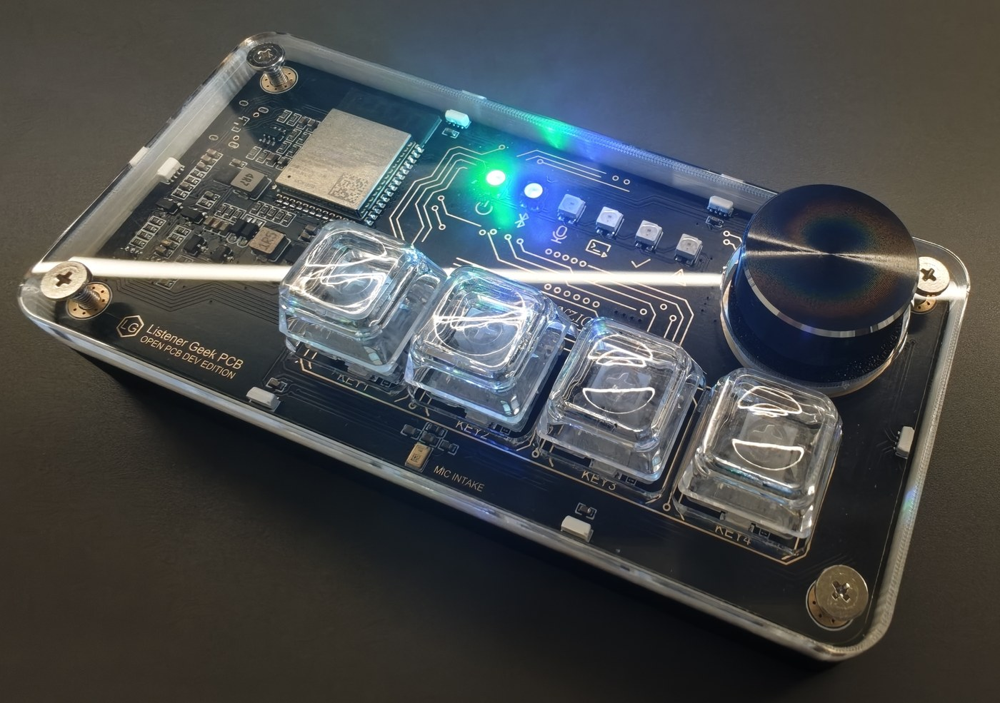

# Listener Type

開源語音輸入軟體。用電腦麥克風或 Listener 鍵盤說話，把文字寫入游標所在的輸入欄位。

[下載 Windows 版](https://github.com/Listener-ai-Macau/Listener-Type/releases) · [第一次聽寫](#先完成一次輸入) · [使用指南](docs/USAGE.md) · [回報問題](https://github.com/Listener-ai-Macau/Listener-Type/issues/new/choose)

Windows x64 編號預發行安裝包已內含 Companion Paraformer Large，可在電腦上辨識中文和英文。請在 Releases 選最新編號預發行版並核對 SHA-256。使用電腦麥克風即可開始，無需帳號或雲端金鑰。

[English](README.md) · [简体中文](README.zh-CN.md) · **繁體中文**

## Listener 鍵盤

選購的 Listener 鍵盤內建麥克風、錄音旋鈕與四顆可自訂按鍵，硬體價格為 49 美元。[韌體與硬體說明](https://github.com/Listener-ai-Macau/Listener-Firmware) · [RC1 韌體 ZIP](https://github.com/Listener-ai-Macau/Listener-Firmware/releases/tag/v1.0.6-rc1)



*Listener 實物照片。計劃交付外觀基本如圖：透明外殼、透明鍵帽、黑色旋鈕；此圖不是操作錄影。*

- **說出來：** 旋鈕開停錄音，電腦上的 Type 完成辨識與寫入。
- **按需要整理：** 預設保留原文，也可在設定文字服務後選擇風格或翻譯。
- **設成自己的：** 自訂四顆按鍵、燈光與電源設定，每台裝置獨立儲存。

**[聽一條訊息變成文字 · 約25秒軟體示例](docs/VOICE_EXAMPLE.zh-CN.md)。** 預錄合成人聲與 Type 實際結果，未展示硬體操作；原音為英文。

Windows 預發行版內含本機辨識模型。需要雲端服務時，可填入自己的憑證，費用與額度由服務商決定。

**RC1 仍為候選版本。** 強干擾分離尚未完善，偶發提前結束仍在跟進，詳見[目前限制與發布說明](https://github.com/Listener-ai-Macau/Listener-Type/releases)。硬體購買入口尚未公布。

[首次設定](https://github.com/Listener-ai-Macau/Listener-Type/blob/master/README.zh-TW.md#先完成一次輸入) · [需要時再查使用指南](https://github.com/Listener-ai-Macau/Listener-Type/blob/master/docs/USAGE.md)

<details>
<summary>已有裝置：韌體、設定與本次版本</summary>

韌體適用 **ESP32-S3 N16R8**，建置 `094f5a60049f59f4`。USB 與藍牙更新選擇同一個 ZIP。
Type 預設使用 **USB 有線燒寫**，能力已內建；無需另裝 Python、ESP-IDF 或其他燒寫軟體。
裝置設定各自獨立：選擇一台有線／藍牙裝置並讀取；完成編輯後自動儲存明確修改，讀取或切換裝置不會寫入電腦預設值。名稱、燈光、電源、按鍵與旋鈕設定儲存在所選裝置。請配套使用本頁 MSI 與韌體 ZIP。

自動輸入來源優先使用就緒的 Listener 裝置，斷線時切回電腦麥克風。進行中的錄音沿原來源收尾。也可以在「設定 → 錄音」或系統匣固定輸入來源。

[Release notes / 发布说明](https://github.com/Listener-ai-Macau/Listener-Type/releases) · [Firmware / 固件](https://github.com/Listener-ai-Macau/Listener-Firmware/releases/tag/v1.0.6-rc1)

</details>

---

## 先完成一次輸入

| 你現在有什麼 | 從哪裡開始 |
| --- | --- |
| 只有電腦 | 安裝 MSI，允許麥克風存取，在「設定 → 錄音」選擇**電腦麥克風**。 |
| 已有 Listener | 在「設定 → 裝置」配對，確認就緒；錄音來源選 **Listener BLE**。 |

Windows 全新安裝預設使用 Companion Paraformer Large，更新保留既有辨識服務設定。先在純文字編輯器試一句，再視需要設定雲端服務。電腦快捷鍵可在「設定 → 快捷鍵」指定。

軟體免費。原文聽寫可使用內附模型，辨識速度取決於電腦。文字整理、翻譯與語音問答按功能要求個別設定。

## 原文與整理按需要選擇

| 你的目的 | 對應能力 |
| --- | --- |
| 保留措辭 | 預設原文模式（Raw）、錄音膠囊預覽、游標插入與剪貼簿備援 |
| 整理訊息或郵件 | Light / Formal；多事項可選「日常清單」，需設定文字服務 |
| 為 AI 程式設計工具準備技術指令 | Structured；風格可編輯與匯入／匯出 |
| 翻譯 | 先選目標語言，錄音時用自行設定的翻譯快捷鍵啟用本次翻譯；需設定相應服務 |
| 協助辨識人名與術語 | 本機詞庫、預設與字面糾錯規則 |
| 取回剛才的結果 | 歷史查看、複製、刪除與保留期限設定 |

串流輸入保持開啟，不再提供關閉開關；實際逐段寫入取決於平台、模式與服務。膠囊文字為預覽，不代表已寫入目標欄位；目標應用阻擋寫入時，依提示貼上並檢查結果。

語音問答目前固定使用火山引擎串流辨識，需 App Key / Access Key 與文字服務；普通聽寫所選的其他辨識服務或本機模型不能替代這項設定。

## 一只旋鈕、四個按鍵、六顆狀態燈

在「設定 → 裝置」連接。單擊旋鈕開始／停止錄音，旋轉預設調音量；雙擊重設配對，持續長按至確認完成後關機。四鍵支援自訂單擊、雙擊與長按，各裝置保留自己的設定。

喚醒詞與聲紋在裝置頁設定。依引導錄三次目前喚醒詞，改詞後重新登記。聲紋可協助降低干擾，但不能保證排除旁人、外放或重疊人聲；這些情況仍需複核最後文字。刪除聲紋不會關閉語音喚醒。登記後在本機建立受保護模板，不保留原始樣本錄音。

[硬體操作與燈語](https://github.com/Listener-ai-Macau/Listener-Firmware/blob/master/README.zh-TW.md) · [折頁指南（簡體中文）](docs/manuals/Listener-fold-ZH.pdf)

## 資料去向與平台範圍

設定、詞庫、風格與歷史保存在本機，憑證使用系統憑證庫。雲端辨識會處理音訊；雲端整理、翻譯與問答處理相關文字。本機辨識搭配雲端文字服務仍會傳送文字。診斷錄音預設關閉。

| 平台 | 目前路徑 |
| --- | --- |
| Windows | MSI；電腦麥克風、主要 Listener BLE 音訊與裝置設定 |
| macOS 12+ | 目前從原始碼建置：電腦麥克風、本機模型與全域快速鍵；Apple Speech、輔助使用插入及正式安裝包仍規劃中 |
| Linux | 原始碼建置、電腦麥克風；X11 快速鍵盡力支援，Wayland 使用桌面綁定 CLI 命令 |

Windows MSI 會註冊用於[文字寫入的 TSF 元件](docs/platform/windows-ime.md)。喚醒與聲紋依賴清晰人聲，多人同時說話時請檢查結果。

## 文件與開發

[使用指南（簡體中文）](docs/USAGE.md) · [English guide](docs/USAGE.en.md) · [功能目錄](docs/product/features.md) · [問題回報](https://github.com/Listener-ai-Macau/Listener-Type/issues) · [發布記錄](https://github.com/Listener-ai-Macau/Listener-Type/releases)

原始碼開發請參考[貢獻指南](CONTRIBUTING.zh-CN.md)，完整桌面建置需要固定版本的 Denzic Platform 子模組。

```bash
npm ci
npm run build
cargo check --manifest-path src-tauri/Cargo.toml
```

[貢獻指南](CONTRIBUTING.md) · [安全政策](SECURITY.md) · [Apache-2.0](LICENSE)
