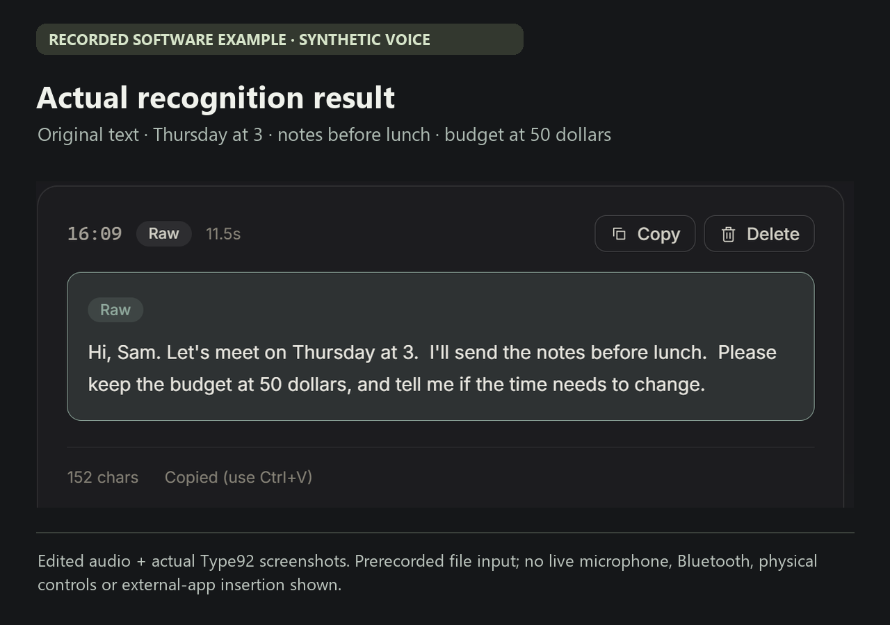

# 软件语音示例 · 约 25 秒

**[观看／下载约 25 秒示例](assets/voice-example/voice-example.mp4)** · [听 11.5 秒原音](assets/voice-example/voice-sample.wav) · [English](VOICE_EXAMPLE.md)

看一条简短消息怎样变成文字。这条英文语音由本机 Microsoft Zira 合成，再交给已发布的 Windows Type build92，通过预先配置的火山识别服务得到真实转写。随后把这份转写放入正常的「文字试用」，用已配置的 DeepSeek 做一次轻度整理。查看这份保存的示例无需账号或安装。

## 原文识别 · 实际结果

> Hi, Sam. Let's meet on Thursday at 3.  I'll send the notes before lunch.  Please keep the budget at 50 dollars, and tell me if the time needs to change.

## 可选轻度整理 · 实际返回结果

> Hi Sam, let's meet on Thursday at 3. I'll send the notes before lunch. Please keep the budget at 50 dollars, and tell me if the time needs to change.

这条结果保留了周四三点、午饭前发笔记、预算五十美元；实际使用仍需检查后再发送。

## 这份示例的范围

短片由原音和本次真实界面截图剪辑组成，并非连续录屏。识别使用预录文件入口，整理另走正常的文字试用。[完整识别界面](assets/voice-example/type92-recognition.png) · [完整整理界面](assets/voice-example/type92-light.png)。

这里没有展示实时麦克风采音、蓝牙、实体按键、自动写入其它软件或噪声表现。一条干净的合成语音不能证明普遍识别质量或实时延迟。

## 另一次实际输入框检查

同一条预录样本还通过已安装的 Type92，写入了一个普通、可写的 Windows Forms 输入框。从实际输入框读回的 **152 个字符**与历史终稿逐字一致，79 次观察中均保持可写焦点。这是另行协调前台时段的检查，不在上方短片里；它不能证明其它应用、实时说话或实体操作的便利。[来源与结果记录](assets/voice-example/example.json)。

Type 免费开源，49 美元为 Listener 硬件价格。示例服务已预先配置，云端用量按服务商另行计费；当前版本不附带开箱可用的官方账号或云额度。[下载与当前限制](../README.zh-CN.md) · [来源与未经改写的返回文字](assets/voice-example/example.json)。
