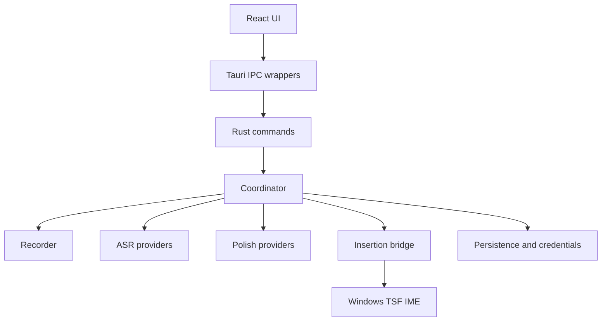

# Listener Type Architecture

Listener Type is a Tauri desktop app with a Rust backend and React frontend. The architecture is intentionally local-first: the app must remain useful without any Listener Type-hosted backend.

## Runtime Shape



## Frontend

- `src/App.tsx` selects the window surface.
- `src/components/FloatingShell.tsx` is the main app shell.
- `src/components/Capsule.tsx` is the compact recording/status window.
- `src/pages/*` implement product workflows.
- `src/lib/ipc.ts` owns typed frontend-to-backend calls and mock fallbacks.
- `src/styles/tokens.css` holds Listener Type design tokens.

The recording capsule renders the newest accepted preview in one update. It
does not replay provider text through a separate character-reveal timer; clause
commitment and provisional text remain backend decisions.

Capsule visibility uses the existing `showCapsule` preference and refreshes the
native host immediately without replaying a dictation state or changing recording.
Disabling it releases only the automatic-wake visibility acknowledgement wait.
`capsule_placement.rs` owns user placement separately from recording preferences:
explicit pointer begin/move/end requests run on the UI thread, sample physical
desktop coordinates and persist once at the end of a drag. Automatic window and
display events cannot write that preference. Monitor-relative bottom/center
anchors survive restart, mixed DPI and translation-badge growth; restored hosts
are clamped to the available work area. Settings can reset placement while hidden.

Automatic wake distinguishes the configured full keyword from one-character
deletion recall candidates. Both use the existing sensitive model configuration;
an early recall result freezes only its own decoder. A separate complete-keyword
stream keeps consuming the same capture and may supersede that result. The
shared phrase reducer admits a complete primary-detector keyword despite missing,
pending or nonmatching secondary recognition. A retrospective recall search keeps
its origin and exact original PCM window even when it returns the full label;
that label cannot promote a recall hypothesis to primary evidence. Recall still
needs recognition of the complete configured phrase on the actual winning input,
without a second unrelated tail crop. Complete local intent is retained separately
from owner evidence and bound to the immutable confirmation input range. Missing
or nonmatching later recognition preserves that proof; cropped or missing source
ranges cannot authorize it. Repetition, near guesses, helper failure, elapsed
time and voiceprint identity cannot complete a command. Live, terminal and early
capsule admission use the same intent qualification; near results remain hidden
and continue ordinary prefix retry and independent complete-keyword detection. Identity remains a separate decision and opening a
capsule does not certify the enrolled owner. Terminal processing finishes the
keyword streams before joining optional local recognition, preserving a final
complete hit even after an earlier partial hit.

A complete primary keyword with reliable token coordinates can also own a
single asynchronous acoustic comparison. The job freezes candidate ID, PCM range,
digest and the claimed endpoint; the BLE actor continues buffering and polls the
finished job, including on its existing quiet tick. A completed full local phrase
on that input retains the existing fast path. Only agreement of raw and enhanced
recognition on a complete alternative, plus the same native phoneme anchors in a
competitive keyword graph, can refute this occurrence. Absence, busy/error and
unproven/repaired coordinates cannot veto a complete keyword. Refutation advances
only decoder context; original PCM and the full local-recognition head remain.
Later commands are still eligible. The helper uses custom keyword streams over
cached trained weights; alternatives live in that stream, never in a persistent
voice profile or global keyword vocabulary. This check grants no speaker, text
exclusion or endpoint permission.

Wake diagnostic audio remains opt-in through an explicitly selected operator
directory. Its filename sequence does not expire after a lifetime capture count;
candidate and raw/boosted helper WAVs share the existing file, byte and age
retention limits so later incidents can replace old evidence without growing
the archive indefinitely. Normal production startup records none of this audio.

Recall token endpoints and decoder coordinates that required observation-clock
repair cannot certify the complete wake phrase's audio end. They remain
estimates and cannot authorize text removal or identity reuse. Original candidate
PCM and the existing provider/editor ledger remain the preservation authorities.

An accepted wake has separate activation and identity coordinates. When local
recognition confirms the phrase without a keyword endpoint, the immutable
confirmation PCM window may seed the session voice reference. Its end is an
identity-window boundary only: it cannot crop dictation audio, strip body text,
or become an endpoint timestamp. Missing, stale or out-of-buffer coordinates
cannot create a live voice exemplar at time zero; the enrolled bank remains the
fallback. This keeps a short pre-wake fragment from causing long inconclusive
speaker runs that freeze otherwise growing provider previews.

The live automatic-wake verifier freezes its exact PCM and capture provenance
when the job is submitted. A direct protected enrolled match can retain the
same-capture original candidate before the provider wake-tail crop, together
with the verifier range, digest and actual result-observation frontier. Missing
or conflicting collector/admission evidence leaves this receipt absent.
The bounded audio remains session-local and does not update enrollment or
authorize transcript words. Native diarization input and common word authority
must still qualify and consume this provenance before granting permission;
terminal continuation transfers it only with a matching old-candidate body
that is fully accepted as the first provider input. An empty, partial or failed
body transfers no receipt. Incoming PCM from a different or unknown physical
capture retires the receipt, so fresh segments must obtain their own binding.

## Backend

Wake PCM normalization owns its warmup and subsequent analysis windows by
sample coordinate. All bytes after warmup enter those same windows, including
the remainder of the call that completes warmup. A window's updated gain takes
effect on its next sample, even within one transport call. BLE packet sizes and
actor batching must not change the samples seen by the keyword model; accepted
and emitted sample counts remain one to one. This does not change phrase or
speaker admission thresholds.

In owner-preserving recording, target activity is three-state endpoint evidence:
owner, independently confirmed other, or unknown. A low binary personal-VAD
probability is unknown. The personal-VAD and existing quality-qualified CAM++
session scorer run concurrently on the same immutable PCM window and join before
advancing its source frontier. Identity evidence is used only for rejected activity
outputs; owner evidence wins a model conflict. This bounded parallel computation
retains the existing freshness guards rather than admitting stale negatives.
Both endpoint references are frozen from one protected profile under one lock,
and capture audio cannot adapt either endpoint reference. The worker preserves source
history and the original owner frontier so missed snapshots cannot turn uncertain
speech into a proven absence span. STOP requires current confirmed-other coverage
after the last owner/unknown frontier, or independently completed actual silence,
and retains the editor-receipt continuation contract.

The source publisher also retains independently qualified Other revisions for
older model-context chunks at their original coordinates. Rejection without
identity remains pending, and any original Owner proof vetoes removal. Transcript
projection and endpointing consume the same immutable model windows through
separately qualified histories. Word projection retains its identity tier plus
native different-speaker and word/source proofs; capture lifetime requires the
existing quality-qualified strong negative identity tier. Inconclusive mismatch
cannot close capture. Each pending frontier can recede only across complete dual Other coverage; a producer
must explicitly certify a complete reconciled history before an endpoint consumer
may retire older pending speech. Partial or missed snapshots retain the earlier
frontier. Actual editor receipts keep their wall-clock three-second allowance.
Endpoint observations alone do not authorize transcript words; the ordinary
speaker projection separately requires its word/source contracts, while the
primary ASR receives all PCM.
Body dispatches freeze the possible-owner continuation frontier (owner or unknown),
separate from confirmed speaker activity. Their matching editor receipt starts
that range's three seconds; a prior dispatch cannot spend later uncertain speech,
and confirmed-other text cannot renew the same range. Uncertainty grants no word
identity and does not manufacture a firmware owner-activity lease.
An admitted body awaiting recognition or submission is an explicit obligation.
Wake-lead admission uses the successfully consumed raw body prefix in both
coordinate orders: a later literal keyword remains body when its lead extends
that prefix, or when the complete current body extends a prefix already consumed
past the keyword. Advancing consumption cannot revoke this admission. A new
ambient preamble or incompatible revision still lacks the matching whole prefix;
unconfirmed submission reservations cannot supply it.
Its age, punctuation changes or a model mismatch cannot retire it. Native
confirmation advances recognition but does not complete submission; consumption
or authority retraction clears the candidate obligation, then dispatch and its
matching editor receipt own the delivery phase. Command-only previews cannot
create a body obligation. STOP admission rereads the current candidate
immediately before the physical write. Matching editor receipts still own the
full three seconds. Coarse CAM mismatches remain unknown at the endpoint boundary
unless the existing quality-qualified strong negative tier is present; no model
threshold is changed. Positive owner evidence retains precedence.
Every positive in a rolling activity window retains its exact source chunk,
including a context chunk reclassified by newer audio. A context positive is
not recast as current unknown activity: its own coordinate supplies the existing
three-second STOP veto while newer chunks keep their independently checked state.

The Windows candidate `asr/multitalker_native.rs` binds the pinned
transcribe.cpp 0.3.1 CPU runtime and trained English multitalker Parakeet Q8
bundle. It consumes complete original 16 kHz mono i16 recordings, without
normalizing quiet samples, trimming VAD regions or cropping long input. Its
temporary 30-second batch bound returns an error for longer recordings;
this is not a limit on product recording. Explicit non-English, mixed or auto
language selection is rejected. Anonymous channels cannot authorize owner
identity, discard text or renew/release the endpoint clock. Native output is
segment ordered, without certified word order, and must not replace already
acknowledged editor text. Asset verification hashes every model and DLL byte
using the Windows CNG SHA-256 provider; expected hashes and file-size checks
remain mandatory, without a metadata-only verification cache.

The English trained-kernel profile remains a source component only. The separate
Chinese activity-mask profile pins the recomposed ordinary Nemotron 3.5 ASR and
Sortformer weights, without pretending it is the trained English kernel. Its
native source tests run in supervised test workers, with a 60-second
deadline, 4 GiB process-tree RSS cap and 2 GiB minimum system headroom. The
decoder callback additionally checks time and memory. Model loading cannot
be interrupted by that callback: production integration requires an isolated
supervised child, shared delivery reconciliation and multilingual qualification.
Source-component evidence is separate from installed-app/device acceptance.

The optional Windows owner-activity-only candidate keeps ordinary transcript
content permission independent of the endpoint detector. Its existing one-shot
empty-final replay can use a complete, bounded PS4 waveform through
`asr/owner_content_extraction.rs` only when pinned exported assets have passed
parity and a verified session-local wake reference is available. Unavailable
assets, invalid output, resource pressure and worker failure preserve the original
PCM. This batch adapter cannot truncate long recordings, grant owner text
identity, change the endpoint clock or add replay attempts. Export validation and
installed-device acceptance remain separate delivery gates.

PS4's internal spectrum calculation canonicalizes an exact terminal all-zero
suffix of at least one second, since bidirectional inference otherwise changes
earlier speech when transport appends digital padding. It keeps every nonzero,
quiet, leading and internal sample, restores that zero suffix at its original
coordinates, and still returns the complete source sample count. The main ASR
and anonymous-channel decoder receive the unmodified full source. This padding
rule supplies no evidence of a speaker or of endpoint silence; real noise tails
remain part of the signal. Fresh installed padding controls are required.

The opt-in Chinese short-content route now supplies one immutable supplement to
the shared product-final arbiter. It requires `ownerActivityOnly`, explicit
`ownerContentRecoveryLocale=zh-CN`, a completed primary send/drain, and the exact
session-local PCM of a direct enrolled wake-verifier capture receipt. Changing
or losing that receipt retires the reference. The personal-VAD seed alone cannot
enable content recovery. Main ASR receives every original byte with ordinary
two-pass correction; the auxiliary uses full-session PS4 audio and first-pass
ordinary ASR. It shares the existing one-shot replay budget. Unsupported locales,
longer recordings, incomplete or revoked capture provenance, model/IPC/service
failure and resource pressure preserve the primary path.

`asr/content_recovery_worker.rs` launches this same installed executable with
`--content-recovery-helper` before any GUI or single-instance forwarding. A
single memory-only stdin/stdout request binds request id, source and reference
hashes, output hash and unchanged sample count. The child receives no credentials
or transcript prompt. A Windows job limits it to one process and kills it on
drop; the parent checks cancellation, 60-second total deadline, 4 GiB worker RSS
and 2 GiB minimum system headroom. Loading and inference are both covered.

The 890,413,984-byte optional activity/content GGUF is outside the Windows MSI.
`asr/content_recovery_assets.rs` prepares a per-user, SHA-named model cache only
when `ownerContentRecoveryLocale=zh-CN`. It imports a verified legacy bundle or
streams the pinned public repository object through a 64 KiB buffer to a private
temporary file, checks exact length and SHA-256, syncs and atomically publishes
it. Interrupted/invalid downloads never replace a ready model. Preparation does
not load inference models and finalization never waits for the network; until
ready, original ASR remains primary. The worker cannot download anything and
independently verifies the cache before decoding. Runtime DLLs and licenses stay
bundled. PS4 retains its original CPU allocator and inference options;
its reference encoder and borrowed output are released after copying the exact
192-float embedding, before the separator is loaded. Weights, thread count,
complete audio and digital-tail handling remain the same.
Startup only warms the WeSep encoder/separator for the legacy extraction mode.
Owner-activity mode sends original audio and explicitly never starts WeSep;
it must not retain unused WeSep sessions solely because a voiceprint exists.
Wake detection, enrolled verification and personal activity still prepare as before.
The personal activity runtime loads its detector independently. Its separate
Nomo enrollment encoder is lazy: an existing protected, model-bound reference
does not need that model. Reference generation still loads the exact original
encoder on first demand and retains it for later generation. This changes no
features, normalization, probability threshold or endpoint decision.

`asr/content_consensus.rs` makes the cross-platform content decision. Only one
local text segment per anonymous channel is qualified. A unique primary-like
channel, valid same-source overlapping activity, and complete tone-aware phonetic
agreement between a missing channel and the auxiliary cloud track can append
that cloud spelling. Every primary byte is retained; only an already-present
suffix is removed from the addition, preserving repetition counts. No result
certifies an owner, word chronology or editor receipt, or renews an endpoint
clock. Certified owner sources and existing foreign vetoes retain precedence.
Normalization and selection occur before the sole final seal, followed by the
existing immutable editor ledger. Six frozen public controls qualify this
limited Chinese candidate, not global speech, exact homophone spelling, live
capture provenance, installed/device acceptance or commercial readiness.

If the personal activity worker cannot supply fresh observations, only a
separate completed local-VAD quiet span can release its endpoint. Unknown
analysis, possible short speech and speech all break that span; polling a
snapshot cannot refresh its age. Out-of-order revisions invalidate the silence
proof until newer input arrives. The reducer retains the full three seconds
after an actual editor receipt and any newer personal positive. STOP admission
rechecks the same policy with the latest local VAD before the device write.
This fallback never classifies a speaker or changes transcript content.

Personal activity input uses exact PCM sample frontiers. Capture-message
rounding cannot break its continuity. The worker drains available input and
uses every new 160 ms score returned by one bounded 2.4 s inference, instead
of recomputing that whole window separately for each queued chunk. The pinned
ONNX head exposes the existing probabilities without changing weights,
features or the 0.7 decision threshold. An intervening owner positive survives
a batch whose final score is negative and invalidates an outstanding STOP.
Analysis that remains behind capture is still unknown; it cannot certify
silence or delete transcript words.

In personal-activity mode, provider candidate settling belongs to a monotonic
owner activity range. Changes to permitted raw background text cannot create
another settling allowance for the same range. Body dispatches snapshot that
range and carry it through their matching editor receipts. Its first confirmed
receipt starts the three-second continuation window; later background receipts
cannot renew it or consume owner activity captured after the earlier dispatch.
Pending dispatches and receipts still veto STOP, and missing activity evidence
remains unknown. Transcript content permission stays independent.

The same three guided enrollment recordings now produce a separate,
model-and-frontend-bound Nomo reference before raw samples are discarded.
Wake, body, separator and personal-activity banks publish as one protected
generation; partial writes retain the previous generation. Sessions prefer
this immutable enrollment over a potentially mixed wake recording.

The enrollment-backed activity worker starts for every admitted session in
personal-activity mode, including full-keyword admission whose current wake
does not match the enrolled person. Command admission and reference provenance
are separate: this never grants that command owner identity, and unverified
wake audio cannot seed or update a reference. An independently verified wake
is passed only as an optional fallback when the activity bank is absent.
Legacy CAM++/separator credentials stay readable and are never reinterpreted as
Nomo vectors. Legacy sessions retain their verified-wake reference until
the existing three-sample enrollment is repeated. Activity evidence continues
to govern endpointing only, with the raw primary ASR path preserving words.

Windows voice-profile entries use version-marked UTF-8 binary credentials,
with their actual byte size checked before staging. Password-backed UTF-16
entries remain readable. Serialized model vectors must not use the password
API: its UTF-16 expansion exceeds the 2560-byte Windows credential limit for
the personal activity bank. The single generation commit still publishes every
bank together. A storage failure keeps the active profile and holds only the
new derived features in memory, enabling a save retry without new recording.
Cancellation, deletion, a new capture or a phrase change retires that draft;
processing results are bound to their capture generation before publication.
The enrollment IPC reports the failing stage so the UI distinguishes rejected
audio from device, model and storage failures. A storage failure offers save
retry, without blaming recording quality or exposing backend exception text.

- `src-tauri/src/lib.rs` wires Tauri plugins, windows, tray, commands and platform setup.
- `src-tauri/src/coordinator.rs` coordinates recording, ASR, polish, insertion and history; helpers in `coordinator/support.rs`; session logic in `coordinator/dictation.rs` (+ `include!` siblings: preview/device_ai/wake_polish/session/embedded_submit/embedded_stream) / `qa.rs` / `resources.rs`; free-function domains via `include!` (`hotkey_device_runtime.rs`, `embedded_ble_runtime.rs`); tests path-separated (`coordinator_tests.rs`, `dictation_tests.rs`).
- `src-tauri/src/persistence.rs` stores settings, history, recordings, vocabulary, style packs and credentials.
- `src-tauri/src/commands/` is the IPC command surface: `mod.rs` (settings/credentials/history + thin device wrappers) with `include!` siblings (`style_pack_commands`, `local_asr_commands`, `diagnostics_export`, `marketplace`) and `device/{mod,settings,ble,firmware}.rs`. Unit tests in `commands_tests.rs`.
- `src-tauri/src/embedded_ble/` owns Windows BLE: `mod.rs` (shared types + public wrappers), `windows_ble/` (`mod.rs` + `include!` siblings: `unpair`, `pairing`, `pnp_cache`, `recording_control`, `capture_events`, `ota_transfer`, `notify_open`, `ota_open`, `gatt_open`), path-separated tests in `mod_tests.rs` / `windows_ble_tests.rs`.
- Provider modules live under `src-tauri/src/asr/*` and `src-tauri/src/llm_*.rs`.
- Maintainability gate: `npm run check:module-budgets` (Goals: `docs/goals/20260727-type-maintainability-excellent.md`, `docs/goals/20260727-type-maintainability-phase2.md`).

The continuous BLE actor owns both the logical dictation session and its current physical audio segment. A new physical `SessionStart` can reset collector statistics, so the actor settles a predecessor `STOP` before admitting an unrelated segment. A request-tagged ENSURE continuation or an active activation race guard may carry the same logical dictation into the new segment; binding it clears the predecessor's tail-drain deadline. An untagged segment cannot inherit the old session by arrival time alone.

The continuous listener renews Type readiness every eight seconds, including
during live audio. The firmware's visible readiness lease can be shorter than
its audio transport lease, so transport availability alone cannot justify
postponing a heartbeat. A single periodic GATT write is polled asynchronously;
audio notifications and urgent ENSURE/STOP requests continue while it is
pending. Failed or cancelled writes retain recovery ownership. Cleanup cancels
a pending renewal before BYE, notify teardown, or an OTA handoff.

Active recording controls also progress by polling one capture-owned WinRT write.
Waiting for ENSURE, STOP or ABORT must not block the notification/PCM consumer.
Queueing, the primary write and its optional fallback share one absolute request
deadline. Cancellation and capture teardown close the pending operation; expired
requests cannot obtain another write budget. Recording controls take precedence
over a pending readiness renewal, which is rescheduled after control completion.
An accepted-wake ABORT belongs to the capture generation that received its ENSURE.
It cannot discover a fresh GATT target or enter a newer capture's command queue.
The product's speaker gates and three-second body-submission endpoint remain the
owners of transcript admission and normal automatic completion.

Dictation delivery follows the OS foreground cursor at each stable clause and at final dispatch. The session-start window is context for style and diagnostics, never a window to raise or restore. A TSF composition is tied to one editor; switching windows cancels its reversible composition and continues through the current-cursor paste route. Preview text may change while it is provisional. Every delivered character remains immutable. The stop result normally appends an uncommitted tail. In raw, untransformed paste sessions, the exact protocol-final speaker-policy-selected native words may also supplement a missing middle span. The shared planner requires a unique insertion-only embedding and whole, valid source words; substitutions, deletions and ambiguous repetitions are rejected. A range transaction is permitted only while the clipboard worker owns a continuous chain of actual paste receipts in the same native editor, with unchanged document, empty selection and end caret. It selects only that exact session suffix through UIA/AX and requires a fresh replacement receipt. A changed, sent, cleared, unsupported or unobserved editor cannot authorize revision or a full-paste fallback. TSF composition retains its separate anchored lifecycle. Automatic wake uses the same prefix stripper for the early-delivery gate as for the final transcript, so a bounded hesitation before the wake phrase cannot suppress all live delivery.

## Provider Network Policy

Cloud LLM and HTTP-compatible ASR providers use a per-provider proxy policy stored with that provider's credential entry in the OS credential vault. The default policy is provider-aware: common mainland China providers such as Ark, DeepSeek, SiliconFlow, Bailian, Volcengine, Zhipu, MiMo and Alibaba/Coding Plan endpoints use direct connections by default, while overseas, OAuth, aggregation and custom providers follow the system proxy by default.

Streaming WebSocket ASR uses the same resolved policy as HTTP ASR/LLM traffic. Direct mode opens the provider socket directly; system mode resolves the platform system HTTP proxy (with standard environment variables taking precedence and `NO_PROXY` respected); custom mode uses the saved HTTP proxy URL and an HTTP CONNECT tunnel. No machine-specific loopback proxy address is embedded in the binary. SOCKS-only proxies remain unsupported by the custom WebSocket transport and are reported as a connection error rather than silently switching modes.

Users can override each provider to direct, system proxy, or a custom HTTP proxy URL. Loopback endpoints (`localhost`, `127.0.0.1`, `::1`) always bypass proxies so local OpenAI-compatible servers keep working even when a stale system proxy is configured.

## Platform Bridges

### Streaming delivery ownership

The delivery ledger keeps immutable submitted editor text and a separate consumed
provider-prefix key. An accepted clause advances both coordinates atomically;
failed delivery restores both. Subsequent ASR revisions reconcile against the
provider coordinate, so correcting an earlier word cannot stall or replay later
clauses. Finalization submits only the uncovered tail.

The editor coordinate owns the complete submitted decorative boundary, including
multi-mark punctuation and closing delimiters. Content-key splitting consumes
the longest already-submitted boundary suffix, so unchanged provider snapshots
cannot emit another mark on each polling tick. New boundary decoration and new
words remain deliverable; failed dispatch rolls back their consumption together.

Final source supplements keep recognition words and display rendering as distinct
coordinates. Valid native tokens remain their lexical/time authority; the selected
response's punctuation is retained only when its complete rendering aligns to those
same tokens. Whole-word insertion runs use that rendering's byte ranges, preserving
all previously delivered bytes and suppressing already owned boundary decoration.
Flattening tokens must not discard commas and terminators from newly added speech.
Unknown, divergent and partial-token renderings cannot borrow this authority.

An unconfirmed ordinary suffix after committed body consumption also has a
separate endpoint-obligation audio check. Its complete native tokens must map
through the submitted word's unique acoustic occurrence in the same capture.
The immutable enrollment bank must give endpoint-grade HardNonTarget with
sufficient speech, and complete raw personal-detector coverage must contain no
Owner positive. A coarse mismatch, missing clocks, different occurrence, absent
audio, unknown detector coverage, or a later detector positive retains the hold.
Complete activity-worker endpoint-grade coverage can resolve the same source
without another inference. Its typed source timeline accepts only the verifier's
strong endpoint tier and retains positive activity vetoes; ordinary word Other
cannot populate it. The frozen bank binding is taken atomically with both
activity references and must still match the current protected profile.
Otherwise one bounded blocking worker scores only that precise suffix; neither
cloud receive nor insertion awaits it. Results bind capture/lifecycle/profile
and the exact current suffix, with queued revisions coalesced and resets
retiring old jobs. This resolves only that suffix's pending obligation: text stays admitted,
recognition remains provisional, receipts still own the three-second clock,
and the endpoint's independently fresh audio/VAD gates still own physical STOP.

Ordinary native-source word identity has a separate natural-speech reference.
It is a single non-persistent RAM exemplar, bound to the protected profile's
generation, phrase, model and immutable session bank. Acquisition requires a
quality-qualified Target from that original bank, an existing Owner source window,
one exclusive definite native speaker in its actual words, and positive raw
personal activity there. Mixed/provisional sources, open wake, absent source PCM,
and matches obtained only through the extra exemplar cannot learn. Enrollment,
deletion, phrase/profile changes invalidate its permission; reset discards capture
observations. Neither the protected bank nor wake/endpoint reference is modified.

The provider receive actor executes cached exact-source row inference on a blocking
worker before publishing that packet. BLE ingestion and endpoint workers remain
independent. Valid current native word clocks must describe the complete available
source interval; a missing or overlapping different source stays Unknown. When the
qualified exemplar is available, quality-qualified Target rows bind current owner
IDs for this word projection. They do not promote ordinary capture into the
stricter source-owner delivery branch or alter its admission permission. A different native
row is removable only with quality-qualified exact-source Other, a current owner
binding, complete raw detector observation with no detector Owner positive, and
no overlapping other native source. Unknown/short sources and owner aliases remain
visible. A rolling identity rescue is not a raw detector positive and cannot grant
the entire anonymous video track protection. Word negatives cannot authorize STOP.
Within a qualified different-speaker source, a boundary positive or unobserved
word cannot grant its complete row protection. Only a contiguous tail of whole
native words may be excluded separately, and each word requires complete raw
detector absence plus complete independent Other identity/activity coverage.
Any positive, gap or Unknown ends that tail; the uncertain prefix is preserved.
This branch cannot use an unqualified reference, an owner alias or overlapping
native sources. It does not reuse rolling-window negatives as native identity.
The same projection owns partial/final/recovery exclusions and current provider
relabeling; it does not revoke already completed immutable editor writes.
Fast settled and provisional previews consume that current source permission too:
neither a longer raw provider draft, an optimistic split nor a recovery floor may
restore rejected words. A shorter reversible draft requires both a current exact
source exclusion and its source-ledger revision; a provider revision or speaker
hint alone retains the existing protection against retraction.
This text permission is separate from endpoint-grade owner-absence evidence and
must never be represented as a stable NonTarget endpoint flag.

Without a qualified natural reference, ordinary speaker projection distinguishes enrolled identity bindings from native
tracks protected against removal by positive local activity. Protection never names
a speaker as the enrolled person. A definite track with positive activity is protected
through the current response; a different definite tail track can be excluded only
with complete, independent identity-Other and activity-Other coverage of each word,
no positive owner overlap, and no overlap with a protected native track. No protected
track or either missing negative channel keeps the ordinary text. This allows known
foreign tails to be removed when absolute owner naming remains inconclusive without
deleting quiet/uncertain words on a protected track. Current source rows rebuild both
sets after provider relabelling. Explicit confirmed empty rows use the same validator
as recognition confirmation and never invalidate the remaining spoken partition.
An exclusion from this current source projection is a veto in the sole final
transcript arbiter and at the product recovery boundary. It cannot be bypassed by
an older, longer preview or session ledger when absolute owner naming is unavailable.
This final recovery veto is separate from rejection of the live primary mixture.
Projecting one foreign occurrence must keep the admitted remaining source available
for live delivery and its pending-body endpoint obligation. Only independent source
rejection can require a separated or independently verified owner decoder.
Every accepted activation records the same control-prefix coordinate in the ASR
state, including activity-only mode with no identity tracker. The delivered body
omits that prefix; pending-body accounting maps it back to the same source before
checking for unseen words. This metadata does not enroll or identify a speaker.

The final native-word delivery plan distinguishes a pure continuation from a middle
omission. Pure continuations submit only the unseen suffix through the current-cursor
route; they do not reacquire or select the old editor range. Middle supplements still
require the exact current owned-range witness, and never fall back to a full paste or
append if it is lost. When a source plan cannot be delivered, clipboard closeout retains
its complete recognized body with all immutable delivered bytes for recovery.
The same plan also records complete native-source coverage. A sealed native word view
that matches the delivered body and its unique submitted acoustic boundary in the same
capture suppresses textual fallback recovery, even if provider display spelling changed.
Equal text without that occurrence or from a different capture cannot prove coverage.

A provider row with missing text but valid ordered words inside its audio interval
is reconciled before any timing, recognition, speaker or merge consumer sees it.
Exact same-occurrence prior rendering may retain punctuation and spacing; otherwise
the current word tokens supply the rendering. The cumulative text must match the
rendered rows with the gap omitted or already included. Divergent main-text lexical
corrections stay untouched. Repair inserts only the missing occurrence into the
existing main text, preserving its numeric separators and literal operators.
Explicit `two_pass_empty` rows are never reconstructed.
An otherwise nonempty response can also explicitly retract an old provisional
audio occurrence. Apply this revision before replacing its previous recognition
certificate and before preview, fallback or final arbitration consumes a cache.
Only complete, aligned, previously observed unconfirmed words fully inside the
explicit empty interval can be removed. Positive owner audio vetoes this
retraction, even while recognition is provisional. Confirmed words, unknown metadata,
partial overlaps and seal-only empty finals preserve the previous speech.
Retained rendering stays exact; editor receipts and endpoint clocks are separate
and are not revoked or renewed by this ASR cache correction. A longer cached
hypothesis cannot recover the retracted provisional occurrence at finalization.
Speaker IDs, native finality and word coordinates stay unchanged, and word presence
grants no owner identity. This prevents an absent rendering from erasing words,
breaking confirmation of later clauses or replaying a preceding clause.

Rolling delivery stability compares spoken content over the existing one-second
window and uses the newest clause punctuation. A late comma or question mark
does not restart a stable body's timer. Numeric separators, literal operators,
and word spacing remain content for stability. A consumed prefix uses the same
shared content coordinate as delivery; formatting changes before that boundary
cannot delay its continuation. Unmapped source revisions retain full-prefix
checks, and current speaker admission still applies.

A fully definite second-pass response can correct `result.text` before its
utterance/word rendering catches up. The response owns a separate complete
recognition certificate only when every nonempty row is definite two-pass,
all word occurrences are valid and ordered, and the existing bounded terminal
alignment maps both each corrected clause to its timed token body and the
complete row body to that response's rendering. An explicit, confirmed and
validly timed empty occurrence has no text/word requirement; an unobserved or
contradictory row still cannot disappear from the response. Clause rendering
edits never add timed word ownership. A timed
response covering the earlier ledger then installs this rendering and its
confirmation together, rather than keeping a longer obsolete hypothesis and
testing it against newer word metadata. Unrestricted/admitted delivery may use
this whole-response certificate; source-projected owner words still require
their exact word rendering and occurrence. Provisional/missing rows revoke the
complete certificate. Submitted editor text remains immutable, and the last
actual body receipt starts the three-second continuation window.

A short early clause can lose its exact prefix after an opening spelling
correction. Shared revised-prefix mapping aligns the complete consumed source
prefix with a bounded edit budget, at least four retained comparison units,
and a unique best seam that retains the last consumed unit. Equal-cost seams,
internal-only insertions, and seams splitting a Unicode character cannot
authorize this continuation. Both live and final delivery append only its
unsubmitted tail and advance the provider key; submitted editor words remain
immutable. This mapping never admits provisional preview past speaker gates.

A bounded provider revision with a uniquely retained terminal source boundary
can certify that no body remains unsubmitted, even if exact prefix matching
fails. This path can append only missing boundary punctuation. Ambiguous
boundaries, repeated anchors, and genuine new body growth remain outside this
certificate and use the existing continuation/recovery checks.

If a correction edits the old terminal anchor, the same bounded full-body
alignment must have its unique best seam at the terminal position and retain
the last content unit. An earlier equal or cheaper seam cannot certify full
coverage. For already consumed body only, that certificate makes known
terminal punctuation eligible immediately, without aging revised words again;
the coordinator submits only the punctuation and advances the source key.
Fresh editor readback still decides whether it can append at the current
caret. New speech retains the normal stability and owner-admission gates.

Speaker exclusions apply to their audio intervals. A retained foreign row still
vetoes raw final recovery, while fresh verified owner speech after that interval
can continue into the live ledger. The receive frame uses the same accepted owner
view for preview promotion and the following merge.

The provider source partition also survives a two-pass revision that merges
owner and foreign rows under one cloud speaker id. Stable rejected rows need
corroborating local NonTarget observations and disjoint owner audio before their
source intervals are retained. Pending identity and simultaneous owner speech
cannot create an exclusion. Revised rows are projected by word PCM coordinates;
excluded text rendering and numeral changes cannot move those coordinates. Live
delivery and final arbitration use the same projected owner rows. Missing word
coordinates permit only previously admitted owner segments in that audio range,
and ambiguous rendering uses the retained timed words. The transport snapshot
preserves the partition; starting a new product recording clears it.

Usable raw local NonTarget observations remain separate from the advisory identity
timeline. The retained owner latch can stay true through a single score dip;
that must not erase the original observation before a delayed provider revision
identifies a stable different speaker in the same audio interval. Only that
correlation promotes the observation into foreign evidence. An owner-track dip,
unusable signal or missing provider identity cannot create a foreign baseline.
The ASR open/reset snapshot preserves unmatched observations until the logical
session ends, and new sessions clear them. Fresh repeated owner windows still
permit continuation after a correlated foreign interval.

A response-local body alias distinguishes a wake-only track splitting into its
first body from a later speaker change after the wake track already carries
owner body text. The latter boundary requires corroborating local observations
inside the new track's own interval, using the same split-identity decision for
direct row admission and alias creation. One coincidental positive among pending
observations cannot assign that entire track to the retained owner. Once an alias
is supported, later same-track Uncertain clauses retain continuity; the original
owner track and first-body recall remain independent of this new-track gate.

Separated audio carries an explicit Owner, Other or Pending identity. Usable
positive owner evidence authorizes the secondary ASR; connection availability,
uncertain similarity, missing identity and failed separation do not. Other and
Pending intervals use clock-preserving silence in the owner transport while the
main recording retains original audio. Pending is never a foreign identity vote.
Physical residual evidence uses the same positive Owner classification as that
transport. A Pending estimate cannot establish mixture-minus-owner interference,
even if a later extracted chunk is Other; otherwise two uncorroborated chunks
could withdraw an already accepted primary transcript without any owner extract.
Independent local NonTarget evidence retains its existing filtering authority.

A distinct provider owner subset can separately survive rejection of the raw
mixture. Its certificate requires an enrolled local identity, usable positive
owner evidence in each accepted body row, stable attributed rows, a real excluded
foreign track, and no response-local alias. Live callbacks and the stable delivery
snapshot publish that subset only; raw or optimistic tails cannot borrow its
certificate. A complete certified final cancels a redundant separator wait and
enters the shared product arbiter as `verified_provider_owner`. A provider label
or reused speaker id alone still cannot restore a rejected mixture.

The reversible visual callback consumes that same response's certified owner
partition when it exists, so a known distinct foreign row cannot reenter through
raw preview after being excluded from delivery. The certificate is recomputed
and cleared on every provider response. Without a certificate, the existing
provisional visual path remains available for uncertain owner continuation; a
previous response's partition cannot freeze a later return.

The same response-local visual boundary applies when an independently confirmed
local hard-mismatch interval overlaps the exact provider row removed from the
optimistic owner view. That row cannot reenter the reversible capsule through
raw preview merely because it has not received a stable provider speaker label.
Low or Uncertain local scores without the confirmed interval keep the existing
fast preview, and a later disjoint owner return is not suppressed by an older
foreign interval.

Delayed positive source-owner evidence can extend a short filtered ledger over
the retained provider word timing. The accepted leading prefix anchors the same
occurrence; every added word still needs an owner interval, and confirmed foreign
or physical-interference intervals veto overlapping words. If the provider
corrects words inside that already admitted prefix, the shared bounded
and unique revised-prefix seam maps only its current source coordinate. This does
not rewrite editor text or grant identity: words after the seam still require
positive source Owner intervals, while ambiguous seams, internal-only growth and
all known foreign/physical overlaps remain blocked. Stability belongs to
the selected transcript revision as well as its ownership evidence. A newer
provider revision cannot inherit the age of an older filtered prefix, and an
unchanged timed revision must not renew its stability clock. Completeness of an
owner-approved unpunctuated tail is compared with the visible body's normalized
content, rather than character counts in wake-inclusive and wake-stripped text.
Agreement between the visible body and stable prefix is insufficient when both
lag behind a newer approved owner candidate. Quiet-only flushing must also cover
the pending owner remainder in the same source coordinates. A newer owner body
waits for stability; punctuation-only revisions do not extend that wait, and raw
or unclassified provider tails do not gain delivery permission through this check.

When physical interference switches live authority to the independent owner
stream, the last owner prefix actually selected while Primary was authoritative
is frozen as the source-coordinate anchor. A longer independent owner candidate
may advance that anchor only when both views map to the same unique prefix. The
original-source projection can then extend it one timed, source-owned word at a
time; an unsupported interval stops the prefix and cannot be skipped. A shorter
or conflicting primary projection never replaces a valid independent candidate.
The shared selection feeds reversible callbacks, delivery snapshots and endpoint
pending-body accounting, so a delayed short secondary callback cannot retract a
longer certified source continuation. Switching from Primary to IndependentOwner
starts a new projection stability generation even when the words are unchanged.
That transition, a changed word-time occurrence, or a projection removed by a
foreign/physical veto also clears rolling delivery revisions; otherwise an old
same-text prefix could make the new evidence generation immediately mature.
Monotonic timed-word growth under the same anchor keeps the history so its old
prefix remains responsive while only the new suffix earns stability.
Secondary callbacks retain only a `Weak` reference to the parent session and
upgrade it for each selection, preventing the callback bridge from forming an
ownership cycle or keeping a closed session alive.

The minimum-fragment guard does not discard a one- or two-character terminal
completion of already committed, unclosed body text when the owner-qualified
stable snapshot supplies an exact continuing source boundary and closes the
sentence. It still rejects standalone short sentences, unclosed placeholders,
missing source coordinates, repeated endings and foreign-authority text. Existing
terminal punctuation readback, duplicate prevention and successful-receipt endpoint
timing remain the authority for editor delivery and the three-second window.

Owner handoff recovery retains the exact audio ranges of its consecutive,
quality-qualified positive observations while confirmation is pending. When the
existing recovery rule confirms the owner, all contributing ranges become
available to timed word ownership together. A quality-insufficient observation
whose raw identity classification remains Target resets the confirmation count
without publishing its range; it may bridge one bounded exact qualified
predecessor to the next two fresh qualified Target windows. This makes callback
ordering and small provider word-coordinate revisions converge on the same
source proof without filling an unobserved gap. A true Uncertain, NonTarget,
missing or invalid range, or non-contiguous observation clears incompatible
provenance. Duplicate and stale observations cannot advance recovery. Provider
and physical foreign ranges continue to veto overlapping words.

Provider text coverage includes every published utterance, including indefinite
rows already admitted as owner speech. Raw-tail recovery subtracts that coverage
once; text stability and speaker identity do not create a second text occurrence.
The physical wake cluster remains a separate anchor from a positively admitted
body cluster. A response-local body alias retains that identity through later
Uncertain windows and sentence boundaries. Confirmed identity departure and
corroborated foreign rows still veto it; an alias is not persisted as a new wake.

An original-source Owner projection can outlive an indefinite provider clause
when room speech continues without a silence boundary. A bounded lexical child
can finalize an already captured PCM prefix while the main capture and provider
remain open. It runs no additional voiceprint or separator and has no preview,
endpoint or product-final callbacks. Its result binds the parent stream,
lifecycle, owner epoch, child decoder and exact original capture byte range.
The child's own definite word coordinates are projected through current owner,
provider-foreign, local-foreign and physical vetoes, without inheriting a parent
accepted-text anchor. The resulting text and current parent Owner view must
share an exact normalized prefix from character zero, ending at whole-token
boundaries on both sides. Online and two-pass timing estimates need not overlap
word by word; that assumption rejected the same captured wake in real replay.
No text search, skipped filler or repeated-phrase resynchronization is allowed.
Only the child rendering and its own certificate become eligible for the
append-only ledger. It never writes the parent's recognition certificate or
text; preview, pending body and final arbitration retain the full primary view.

Snapshot work is single-flight, has a twelve-second cancellation budget, and
never retries revisions within an already attempted PCM frontier and submitted
anchor generation. Extra PCM transport is bounded to twice the captured bytes.
Whole-prefix snapshots cover the first sixty seconds. Longer captures can use
an origin-proven clip beginning before the last successfully submitted word,
with at least one second of captured post-context and at most sixty seconds of
PCM per clip. The submitted raw prefix and its capture/generation/word bookmark
anchor the occurrence; they are never assigned the child's recognition proof.
Child-local times are explicitly shifted to original capture coordinates. Both
current parent and child must locate that same unique whole-word seam; only the
common new suffix is projected through current Owner and foreign permissions.
Its timing contains child words only. Full display conversion must preserve the
immutable submitted prefix, and the chosen display segment must map to a whole
child token before submission. Successful submission advances all bookmark fields;
failed reserves preserve them. Old-generation worker results cannot be consumed
again. Newer approved owner audio keeps quiet completion pending. Origin-unknown
or ambiguous seams retain the primary/final path without inventing authority.
The long-capture path still requires recorded and installed physical acceptance.
A distinct child namespace conservatively earns delivery maturity again.
STOP, cancellation and both normal/deferred transport reopen seal or reset the
snapshot lifecycle; late completions cannot reopen it. Snapshot completion does
not refresh an owner endpoint clock or prove an actual editor receipt.

When recording diagnostics are enabled, a private `*.delivery-trace.json` beside
the session WAV records intended text, cumulative submitted text, source coverage
and target acknowledgment separately. Submission alone is not editor readback;
preview/final differences alone do not prove lost or duplicated text.

Final clipboard retention uses the cumulative immutable delivery ledger for
streamed sessions. A single clipboard worker owns paste payloads and deferred
retention jobs by generation and native clipboard revision. It captures the
focused editor before dispatch and observes a read-only UIA/AX diff immediately
after each paste. A positive consumption receipt is latched for that payload
generation, so submitting or editing the message before dictation ends cannot
erase it. Final retention uses this receipt before replacing the last payload
with the whole session; it does not reconstruct a receipt from the editor's
later state. The worker releases native readers after bounded failure or an unscoped
confirmation. Scoped paste confirmations retain one bounded native editor and
document witness until the next paste or final retention, without continued
polling. Its lifetime stays on the clipboard worker. This witness can authorize
only a lossless source supplement after a fresh native identity/document/caret
check. Logs record counts and failure shapes without editor text.
Native edit prediction partitions the exact captured document at the actual
selection. UIA uses native prefix/selection/suffix ranges; AX uses its UTF-16
selection coordinates. The predicted receipt preserves all three ranges,
including user line breaks and provider paragraph markers. The clipboard
worker does not trim document endings or infer the insertion seam from a
matching suffix. Changed or unpartitionable snapshots grant no edit witness.
Clipboard consumption has two explicit proofs: an exact edit of the observed
document, or a changed whole document equal to the current paste payload. The
latter handles accessibility prompts exposed as empty-editor document text
without guessing a placeholder string. It confirms only this payload's presence;
it does not establish preservation of earlier text or whole-session acceptance.
Existing unchanged text, partial matches and later unrelated edits are not a
receipt. Both proofs remain scoped to the same native editor and clipboard owner.
Clipboard retention never dispatches a second paste, selects text, or restores
focus. A separately authorized session-range supplement is one native selection
and one replacement dispatch with its own actual receipt; failed or uncertain
revision never falls through to append or Unicode typing. User copies and newer
app writes supersede both the range witness and pending retention. Missing readback or a timeout
cannot authorize a clipboard overwrite; history still provides the full body.

Clipboard writes carry a shared purpose: temporary paste transport or retained
user text. Transport clauses remain ordinary pasteable text but are excluded
from native clipboard history (and Windows cloud clipboard) in the same write.
Windows uses the documented history formats through arboard; macOS uses its
clipboard-manager exclusion adapter. After consumption, the cumulative body is
published once as normal retained text. A single-clause session must also publish
when its final text equals the transport payload: equality of text does not mean
equality of history policy. That publication keeps the same bytes for delayed
readers and never sends a second paste. User copies and new sessions retain their
existing generation/revision protection. Existing clipboard history is not cleared.

Focused input state is an explicit native fact: editable, positively non-editable,
or unknown. An exposed non-input container defers paste before any transport write,
shortcut or delivery ledger commit. At completion its whole owner transcript may
be published as copy-only without inventing an editor receipt. Unreadable custom
or web controls remain unknown and keep the existing paste compatibility path.
The worker protects any outstanding paste lease even if a later caller asks for
copy-only retention; neither a target change nor a false receipt hint releases
an asynchronous reader's payload. Copy-only success is reported only after the
full body was stored and never authorizes a post-dictation send key.

Pre-wake preamble rejection uses the admitted source prefix of this session.
Once that prefix has been submitted successfully, mentioning the wake phrase
later in the same body cannot re-run initial admission and block streaming.
An uncovered preamble, a pending reserve, or another session's prefix is not
admission evidence. Speaker filtering and source-tail alignment remain active.
Exact timed activation-prefix evidence also resolves this boundary before the
first editor submission. Normalization retains that provenance alongside the
body; a later literal wake phrase cannot be mistaken for an unstripped preamble.
An incompatible provider revision or another session cannot borrow the evidence.

Live and final output use the same actual polish disposition. When a known auth
rejection or open stall circuit makes final output raw passthrough, already
confirmed raw clauses remain eligible for live delivery. A healthy rewrite and
translation remain deferred; fallback does not change the user's saved style.
The credential fingerprint is sampled once per recording instead of querying
the credential vault on every endpoint tick. A successful irreversible raw
submission fixes that recording's raw output contract through final completion,
even if the rewrite circuit recovers or style/translation changes later. An
unconfirmed reservation does not establish that contract; subsequent recordings
resolve their own credentials and requested output independently.

The endpoint may pause for provisional provider text while the local verifier
continues to observe the owner. A newer quality-qualified owner watermark also
updates that paused deadline. A settled callback restores the latest verified
origin; an old provider boundary cannot resurrect an earlier silence deadline.

Local capture, pending speech and confirmed voice have separate boundaries.
An asynchronous VAD normally trails capture by one chunk; unprocessed energy
may hold an endpoint but cannot create a positive owner watermark. The speaker
sampler selects a bounded PCM window ending at the VAD-covered speech edge and
labels the observation with that edge, rather than the newest capture time.
Pending onset still vetoes an unsafe STOP. Platforms without this VAD adapter
retain their existing sampler; an initialized detector returning Unknown is
not confirmed speech. Quiet evidence must not turn noise-only voiceprint
scores into transcript aliases or continually renew a three-second deadline.

An owner-analysis wait budget belongs to the qualified owner watermark. Ending
and restarting asynchronous background jobs releases their active hold but does
not grant a fresh budget. Expiration remains latched until new qualified owner
activity; provider revisions and repeated foreign/noise windows cannot renew it.
The same bounded barrier includes a complete original-source chunk already
accepted by the enrolled-profile worker but not yet classified. Its
processed-through frontier excludes a partial chunk that can only be finalized
after STOP. A newly published, unvetoed original-source Owner range is positive
owner evidence; physical overlap and confirmed provider/local foreign ranges
retain their veto. Confirmed Other releases the barrier immediately.
After body delivery in a tracked session, provisional preview growth also cannot
reuse one old owner edge to renew that budget. New qualified owner observations
still renew continuation. Before first delivery, and without local tracking,
flowing body growth retains its existing startup and continuation protection.

An unchanged admitted transcript is not a completeness certificate. Early final
sealing compares it with the latest nonempty provider revision and pending source
tail; unresolved content vetoes sealing without admitting raw mixture as owner
text. This keeps the provider alive to finish speaker attribution and final text.
Punctuation-only revisions do not hold the body boundary, and a superseded longer
provider revision cannot permanently block a now-complete shorter owner result.

Independent owner audio also supplies live transcript authority. Strong physical
interference plus an explicitly rejected extracted voice switches product preview,
streaming submission and final supplementation to the owner-only provider. Noise
residual or an unusable extraction alone does not establish another speaker. While
the owner provider is pending, retain source evidence without admitting the mixture
or deleting submitted owner text. Early final sealing and raw-tail recovery cannot
bypass this same boundary or cancel the owner worker before arbitration. Platforms
produce evidence through their adapters; the authority decision remains shared.

Cancellation and successful completion have separate actor cleanup. An externally
closed Idle state with a cancelled session must run the session-owned cancel path
before releasing its actor: preserve debug audio and trace under the user's existing
recording preference, settle only that session's ASR resource, and keep continuous
capture ready. Idle by itself is not a successful-final certificate.

- macOS uses Accessibility/keyboard event paths for hotkey and insertion.
- Windows uses low-level hooks for hotkeys and Listener Type TSF IME for reliable insertion.
- Windows IME identity is documented in `docs/platform/windows-ime.md`.

## Wake confirmation source and parallel verification

Wake phrase evidence belongs to the immutable PCM supplied to its local confirmation.
A later body chunk must not move that identity boundary. The bounded Windows local
confirmation launch also schedules verification of the same retained snapshot; it
starts no additional owner inference while another is in flight. A real keyword
endpoint takes precedence. Near-phrase repetition can guide a recognition retry,
but cannot create phrase intent or bypass the full-buffer keyword pass. Fallback duration checks use the actual verified window,
not later accumulated PCM. Missing/expired source ranges retain current verification.

The endpoint clock still starts at the last successful confirmed-body submission.
Wake inference scheduling does not shorten the full 3000 ms continuation window;
fresh owner speech protects recording and a new body submission restarts it.

## Pending speaker handoff and the endpoint

A reversible cloud speaker-handoff candidate remains Pending. It suppresses
owner-watermark renewal and retains transcript isolation, but it cannot publish
raw VAD speech as confirmed Other. Only the corroborated sustained local Other
boundary crosses that adapter. During the last submitted body's three-second
window, unresolved speech can veto STOP without authorizing text or manufacturing
owner identity; real quiet and confirmed Other retain their existing termination.
Beta.23 device session cc267192 reproduced the incorrect Pending-to-Other mapping.

## Live delivery and endpoint handoff

Provisional provider words use the same half-open midpoint ownership rule as
source-partition recovery. Independent PCM window edges do not require complete
word coverage; an unobserved midpoint blocks the contiguous suffix and a known
foreign overlap vetoes a new word. Previously admitted text remains source-scoped.

The endpoint reads only approved, unsubmitted body from the same live source used
for paste. An unresolved recognition or delivery obligation cannot expire into
permission to STOP. Repeated text and punctuation do not create a new body or
renew the last actual body receipt; source consumption or valid source retraction
clears its obligation. Editor availability does not certify silence or consumption.

Body submission reserves a sequence before calling the platform adapter. Pending
submission/readback blocks STOP; only a matching editor receipt moves the three-
second clock from dispatch to observed delivery. Late receipts cannot clear owner
speech after dispatch or overwrite a newer sequence. Unsupported, expired and
superseded readbacks release the hold without inventing confirmation. Punctuation
alone cannot restart the body timer. Actual editor/device acceptance stays separate
from the simulated receipt and recorded-PCM regressions.

Successful streaming submissions retain a source word and its PCM range alongside
the consumed source key. When two-pass recognition changes the already submitted
opening, an owner-approved snapshot may locate that same word (including a split
tokenization) by unique text and audio occurrence, then append only its suffix.
Pending reservations cannot use this bookmark; rollback preserves the preceding
successful seam, and a new session/source cannot borrow it. This coordinate proof
does not replace the speaker gate or revise words already in the editor.

Raw provider consumption and rendered display reconciliation are separate
coordinates. The successful submission transaction commits the raw prefix,
control/body byte boundary, capture identity and optional native word/audio seam
alongside its rendered key. Wake/filler removal, script conversion and corrections
map through the actual deterministic display policy; a cut inside an expanded
correction cannot invent a raw boundary. In-flight reservations do not advance the
committed cursor, and rollback preserves its preceding source occurrence.
Provider prefix stability, callbacks, the watchdog and physical STOP revalidation
use that same committed raw cursor. A same-capture word/audio seam can locate a continuation after an earlier
word revision. Unmappable admitted content remains pending; only a complete valid
native partition wholly before the submitted audio edge proves an old-only
revision. Timed continuation resolves in raw text before rendering its suffix;
later literal activation words use the raw admitted body coordinate. Local debug
delivery archives retain this raw cursor separately from displayed submission.

The selected delivery rendering carries its own word timing into the coordinator.
Equal text in the primary, independent or finalized snapshot decoder cannot fill
missing timing, or certify a different occurrence of repeated speech. Lexical
confirmation is checked against that selected timing before delivery. The saved
seam retains the capture stream, capture generation, decoder and owner generation;
timed continuation requires the same capture even when a decoder retokenizes its
words. Reopening an ASR object changes the capture generation. Cancelling or
replacing a snapshot worker does not, so ordinary decoder progress cannot erase
a valid submitted boundary. Missing timing keeps the existing text reconciliation
path but supplies no audio seam proof.

## Runtime resource retention

Target-speaker encoder and separator sessions stay loaded for low-latency wake
and dictation. Each inference requests ONNX Runtime CPU arena shrinkage, so
unused temporary regions are released after a chunk without changing model
weights, outputs, speaker gates, or endpoint decisions. The acceptance checklist
WebView is created from its configured window definition on first use. When
startup is minimized and automatic update checks are disabled, the main WebView
also waits for the first tray/CLI show request. Automatic updates keep their
hidden main WebView because its AutoUpdateGate owns the update schedule. Native
window materials are applied at creation. Capsule and QA remain prepared at
startup so recording state events and the first hotkey response are preserved.

Development builds retain limited debug information and disable incremental
compilation by default. Debug build directories and release incremental caches
under `src-tauri/target` are reproducible build data, separate from installed
models, preferences, voiceprints, history, and saved recordings.

## Data Boundaries

### Confirmed activation and interval-scoped speech recovery

An automatic wake's local confirmation window and provider word coordinates use
the same retained PCM clock. Until that confirmed activation is located, ambient
prefixes are provisional. The local recognizer's confirmation input end is not a
hard endpoint for independently timed provider words. One unique exact phrase
may be anchored by its first complete provider word inside the confirmed PCM;
its separate aligned final word supplies the activation endpoint. Missing or
conflicting coordinates, mixed phrase/body tokens, and later phrases beginning
outside the window cannot supply this proof. Exact activation fragments may resolve across revisions
only at the same leading source boundary and within that immutable window. A final
without coordinates may strip an exact leading activation; it cannot infer an
ambient prefix from text alone. Literal later mentions remain ordinary body text.

The separator output and original microphone input have separate identity evidence.
Other/Pending on a separated chunk does not classify the original chunk. The existing
verified session profile also checks bounded original chunks, requiring Target and
usable signal; a delayed profile retains at most two original chunks for later proof.
For cross-phrase coverage, the original-source verifier may retain at most two
session-only body references, each independently classified by the immutable base
profile with adequate signal and its existing strong admission threshold. A context
match cannot admit another reference or modify persisted enrollment. It can resolve
an otherwise uncertain original window through the unchanged positive threshold;
base NonTarget, inadequate signal, and physical/provider foreign intervals retain
their veto. No raw text, preview growth, or separator identity supplies this proof.
Only independently owned, source-timed primary words outside measured interference
may supplement the separated owner transcript. Known foreign intervals remain vetoes.
Supplementation uses unique, same-word timed occurrences to locate decoder gaps.
An unmatched secondary clause owns its complete audio span; independently certified
primary words entirely before or after that span can still fill omitted clauses.
Conflicting decoder alternatives inside it cannot be concatenated as missing words.
Repeated words require their own audio occurrence; ambiguous or crossing anchors
cannot authorize a splice. Fine original-owner intervals retain their own authority;
coarse source-chunk ownership additionally requires extracted Owner coverage before
restoring an omitted word. This prevents a broad primary Owner chunk from restoring
an unsupported background tail. A recovered gap uses the primary punctuation at
its same-word left anchor so a premature secondary full stop does not split a word.
Subsequent provider punctuation rendering requires an exact spoken-character
prefix under the existing digit equivalence. An edit-distance budget cannot
substitute primary words or consume a short foreign span after owner selection.
Physical chunk seams retain their half-open midpoint rule, and explicit foreign
intervals veto the complete word range. The
accepted primary candidate retains matching word coordinates independently of its
shorter contiguous live delivery prefix. Reopening ASR clears all prior coordinates.
An empty provider marker contributes no text or ownership and does not truncate
later word coordinates. A spoken row without coordinates remains a timing gap.
Final source reconciliation requires a single snapshot whose word coordinates
cover the complete requested text; a matching text label on a prefix-only
snapshot cannot supersede a later complete provider snapshot. Streaming preview
may still retain partial timing while awaiting later evidence.

Completed local speaker inference publishes its covered PCM evidence immediately,
independently of the next audio mailbox drain. The mailbox remains for adaptation
and reporting; it cannot repeat identity votes. A typed confirmed-owner partition
may correct reversible visual text after foreign evidence settles, preserving the
authoritative owner floor without renewing visible-growth or endpoint clocks.
Provisional text arrival never becomes a new positively classified PCM watermark.
The capsule treats an explicit empty message as a preview correction and clears
that provisional text. An absent message remains a level-only update that
retains the current preview; filtered startup status is not a clear command.
Timed provider words within already captured PCM also schedule local speaker
analysis when the local VAD misses that speech. Their coordinates select audio
only; they do not qualify an owner, renew the endpoint, or override a foreign
verdict. Missing, reversed, or future coordinates are ignored.

The provider's 500 ms silence boundary confirms recognition clauses; it is
independent of the owner's three-second continuation window after editor receipt.
A 300 ms candidate confirmed clauses sooner on a short-pause recording, but a
neighboring recording lost a spoken particle in both definite clauses and the
provider final. That candidate did not pass the full-content gate and is not the
default. Compare send cadence and full spoken content across recordings before
changing segmentation; a provider-only speed result is not speaker, editor or
endpoint acceptance. Initial one-second voice protection and two-pass recognition
remain unchanged.

Irreversible live insertion intersects the selected Owner candidate with that
decoder's recognition confirmation. When the provider advertises `definite`,
the emitted prefix must have matching word text and valid ordered audio
coordinates in confirmed clauses. Provisional Owner text still drives reversible
preview and pending-body endpoint accounting; identity permission alone cannot
promote it into the irreversible delivery ledger. Independent Owner fallback carries its child
decoder's confirmation, while an original-source projection uses the parent's.
The admitted delivery snapshot retains its recognition stability through the
coordinator. A native-confirmed prefix ending at the confirmed rendering or a
complete confirmed timed word does not wait again for local punctuation, minimum
text length or preview quiet. Cropped child continuations carry the same native
confirmation only after their existing occurrence, permission and lifecycle checks.
Legacy rolling-stable views retain the placeholder batching guards. Neither kind
of recognition evidence replaces the source seam, editor transaction or actual
submission receipt used to start the owner's three-second continuation window.
When local speaker tracking is enabled, a raw Primary best transcript without
an admitted Owner ledger remains pending even if every word is definite. It can
still drive reversible preview, but cannot create an Owner delivery-settling
hold. Unresolved speech retains the independent bounded VAD/identity-analysis
guards; recognition age cannot substitute for missing speaker permission.
`definite` already certifies lexical stability, including a corrected clause;
confirmed words under established Owner authority do not pay a second lexical
wait. Legacy responses without this contract still use rolling word stability.
Fresh original-source projections separately earn ownership permission age,
even when their words are definite. History is scoped to the actual decoder,
authority and permission generation; selecting a different implementation path
under the same authority does not itself revoke permission. A source switch or
revoked authority starts a fresh permission age even for identical confirmed
words. Confirmation never renews the Owner endpoint clock. Missing metadata
cannot downgrade a contract already advertised in that session. Reopening a
stream clears recognition certificates, stability and the cached visual result.
Provider clause confirmation is not stream completion; final arbitration and
the real editor receipt remain separate requirements.

Revisable live editor text uses a separate Owner snapshot and input transaction.
It is opt-in through LISTENER_ENABLE_REVISABLE_EDITOR=1 until actual native-editor
acceptance is complete; ordinary confirmed-clause insertion remains the default.
An initial unavailable target has not revoked a written range and may be retried.
Before any reversible write, Windows ValuePattern text must agree with TextPattern
text apart from a terminal paragraph marker. Accessible placeholder text cannot
become the baseline for an exact session edit. Confirmed display remains immutable;
only an owned, unchanged same-editor draft tail may follow provider revisions.
A draft readback never consumes recognition or starts the three-second clock.
Certification of unchanged draft bytes requires a fresh owned-range readback.

A confirmed paste with an unavailable caret retains its exact document witness;
a fresh same-target, unchanged-document, empty-selection, end-caret observation
is still required for the next edit. Explicit edits, sends, target changes or
lost range authority block blind full replay and duplicate append. Input failure
retires output authority only: it cannot request physical STOP, infer speaker
silence or consume pending recognized body. Recording STOP belongs exclusively
to recording controls and the activity/actual confirmed-body endpoint. Existing
optional per-session delivery diagnostics distinguish gate and receipt states.
The separate opt-in TSF adapter retains its own composition lifecycle.

Firmware ENSURE continuation retains request ownership across predecessor STOP. The
Type transport must keep awaiting that request-tagged successor while the request is
pending, even if the old segment already supplied body PCM. Untagged ambient starts
cannot satisfy the request, and explicit cancel/expiry remain terminal.

- App data directory name: `Listener Type`.
- Logs: `Listener Type/Logs/listener-type.log`.
- Credential vault service: `com.listener.type`.
- Remote marketplace: disabled until `LISTENER_TYPE_MARKETPLACE_BASE_URL` is configured.
- GitHub OAuth: disabled until `GITHUB_OAUTH_CLIENT_ID` is configured with a Listener Type-owned app.

## Speaker Signal Quality

Speaker observation quality shares the continuous VAD's PCM timeline. Completed
speech and stable gaps constrain the maximum possible speech inside the exact
observation window; active, unprocessed, expired or unavailable coverage remains
possibly speech. This may downgrade an energy-derived quality claim, local
negative identity, transcript foreign evidence and reference adaptation. It
never grants a speaker identity, deletes words or treats a missing result as
silence. Original-source owner classification uses the same quality bound.
The ledger is bounded and replaced with a new Arc during synchronous session
preparation before a capture worker binds it. Asynchronous network open must
preserve the bound Arc; old workers cannot publish old PCM coordinates into a
new prepared session. The Windows
adapter preserves onset/silence lookback; it does not restart VAD for each short
speaker window. Physical speaker accuracy and per-word output authorization
remain separate acceptance requirements.

## Update Boundary

Updater metadata is scoped to `Listener-ai-Macau/Listener-Type`. Third-party mirrors are opt-in only.

## Traceability

Every tracked source/config/script file must appear in `specs/traceability/files.md`. Update it manually or run:

```bash
npm run check:traceability -- --write
```

### Independent extracted-output identity and complete drain

The separation conditioning encoder supplies model input and diagnostics only.
Each serialized extracted waveform has its own continuous VAD and immutable
session-speaker profile context. Original-mixture body references cannot seed
that context. One extracted-output decision supplies transport, owner ranges,
physical residual eligibility and diagnostics. Pending PCM remains in order;
only independently identified Other or same-source confirmed silence receives
an equal-length zero transport packet. Missing quality never supplies identity.
Strict extraction is armed only after an enrolled owner identity is verified,
matching the profile publication boundary. Open wake keeps its normal recording
and primary transcription path; it cannot start a worker whose output has no
eligible identity profile and later turn that optional worker into a final-text
failure.

After STOP, the separator input closes and its complete worker is joined before
final arbitration. Exact enqueued/processed byte frontiers and unresolved output
are retained in a reasoned result. NoOwnerEvidence and Unresolved cannot certify
a clean primary. The existing provider/secondary arbitration remains separately
responsible for choosing text, with real editor receipts required for delivery
acceptance.

## Cloud owner identity integration candidate (2026-10-05)

The existing SAUC provider supports one registered voiceprint in short-audio 1:1
verification mode. The candidate keeps the registered speaker name separate from
anonymous diarization IDs. A first anonymous speaker, a local wake match, absent
speaker metadata, and an unmatched final packet cannot grant cloud owner output.
Named owner rows alone feed the authoritative callback, source timing, disconnect
fallback and terminal delivery. Unstable named rows remain reversible previews.
The configured identity is copied to bounded audio replays; it is checked against
the provider registry and current account before opening a session. Local wake,
VAD, original capture receipts and editor receipt continuation remain in place;
local in-session identity and separation workers do not override cloud matches.

This is an intermediate provider candidate, **not a multi-customer release**.
The product has two routes: subscription-included managed cloud and customer
BYOK. Email accounts/subscription entitlements are being built separately. The
managed route requires an authenticated Listener service that owns the shared
provider secrets, maps stable customer subjects to individual voiceprints, and
binds each customer's ASR session on the server. In BYOK, the customer's own
provider credentials remain in the protected OS vault and go directly to their
provider; cloud identities must be bound to that account separately from the
managed identity. The service supplies private, temporary upload authorization
for the existing three guided enrollment samples in both routes. No customer
should supply an AudioUrl, configure TOS, browse the entire operator registry,
or receive the operator's cloud account secret. Switching routes must select
the correct identity and entitlement without silently borrowing another account
or charging both routes. The gateway and native candidates implement these
managed/BYOK boundaries; email login, production account issuance, storage and
deployment still require integration and acceptance.
The optional gateway candidate now lives in `services/voiceprint_gateway`, with
the account/token contract and deployment instructions in its README. It is not
deployed. It verifies short-lived signed email/subscription grants, stores separate
customer/route/provider-account bindings, joins the existing three accepted guided
samples in private storage, and binds managed sessions on the server. BYOK keys
remain on the desktop and go directly to the provider; BYOK registration receives
one temporary audio grant and cannot authorize managed sessions. SQLite operation
states prevent blind repeated creates after uncertain responses, and atomic quota
reservations/tickets prevent cross-customer or repeated session use. Native audio
sequence retries are forwarded/accounted once. Temporary audio is removed on
success; deployment requires private-bucket lifecycle cleanup for incomplete work.
This single-replica service candidate is not evidence of production scale.

The native `asr/cloud_gateway.rs` client and `commands/cloud_account.rs` account
ports consume that service. Explicit cloud consent arms the same three-sample
capture, without a fourth prompt or a customer audio URL. Managed dictation, QA,
platform providers and bounded recovery use authenticated session tickets and
strict named-owner projection. Managed profiles are fetched per session; the
existing direct BYOK profile remains separately account-bound. Account changes
invalidate queued managed audio, provider frames and old-account recovery. Active
cloud binding deletion follows local deletion without disabling wake. Cloud
enrollment failures preserve the protected local template. Account tokens share
the existing chunked OS vault and are absent from settings/snapshot IPC.

The cloud URL defaults to empty. Email UI/login/payment integration belongs to the
account project and is not connected yet. Bounded public-cloud tests have now
confirmed registration, independent same-speaker short speech and foreign-only
rejection. An equal-RMS overlap still loses the independent owner's three words
in the raw ASR result, before client projection. Recorded provider frames test
the shared preview, owner ledger, callbacks and final projection; they do not
validate a device, editor insertion or the deployed product. No candidate has
been installed for this cloud route. Source HTTP/WebSocket isolation tests do not
establish provider accuracy. Manual URL registration and global registry IPC
remain absent.

A registry create can reach the provider even when its response times out. Both
managed and BYOK adapters reconcile such an uncertain create once using the
unique enrollment operation name: a bounded registry read must find exactly one
active match, and a Get by that id must confirm the same name and provider
account. This path never repeats creation. Missing, deleted, ambiguous or changed
records remain unknown, preserving the previous customer binding. Explicit
rejections and conflicting response ids do not enter the recovery path. The
original swallowing/interference repair is still unaccepted; avoiding new RTC
fees does not make voiceprint identity alone recover words missing from ASR.

ASR voiceprint registration accepts 5–30 seconds but requires a cloud-readable
AudioUrl. Existing protected local embeddings are not provider voiceprint IDs;
raw enrollment audio has already been discarded and cannot be silently reused.
The public ASR documentation limits this mode to short, single-main-speaker audio
and does not establish separation of overlapping drama speech. New owner-only,
foreign-only and overlapping-drama sessions remain required before claiming the
original swallowing/interference defect is fixed.

### Ordinary ASR speaker tail and source revisions

The owner-preserving ordinary ASR route projects provider utterances through a
session-owned source ledger. The local activity worker retains independent
protected-enrollment identity windows and fused activity chunks at their
original capture coordinates. Definite provider speaker IDs are anonymous;
disjoint locally verified owner windows may bind multiple IDs to the same owner.
Binding requires positive activity in native word coordinates inside a qualified
identity window. Activity chunks need not cover the whole identity window:
unknown chunks cannot erase that positive proof. Activity outside native words,
outside the verified window, or without independent identity cannot name an ID.
Mixed identity windows cannot authorize either ID. Only a continuous foreign
word suffix covered by both independent Other identity and Other presence may
be excluded. Any local Owner evidence or overlapping bound owner track vetoes
exclusion; unknown, missing or stale coordinates preserve ordinary text. Later
Owner evidence can restore an earlier exclusion at its original coordinates.

The session's request contract determines revision scope: `result_type=full`
replaces the whole capture rendering, including two-pass spelling and word-clock
corrections. It does not require new word bounds to fully cover the old draft's
bounds, or an old legacy ledger's spelling to be a prefix of the new rendering.
`single`/window results retain earlier nonoverlapping occurrences and still need
coverage before replacing an older range. Word identity uses only the current
packet's validated clocks in either scope. Unchanged excluded occurrences remain
excluded when a newer unknown/pending row arrives.
Preview, live clause confirmation
and final arbitration consume this same revision; raw recovery cannot reinsert
an excluded suffix. Genuine repeated words at disjoint times remain distinct.
Text/time disagreement declines projection rather than assigning older clocks
to new text. Existing text-only merge remains the fallback for unmappable frames.
Endpoint ownership and the actual-submission three-second clock are unchanged.
This route adds no cloud registration, model download or enrollment prompt.
The bounded private diagnostic trace retains the newest native frames when full,
so a long capture's terminal text and speaker projection remain inspectable.
Synthetic source and receiver contracts do not establish provider identity or
multilingual audio accuracy; installed owner/video use still requires evidence.
